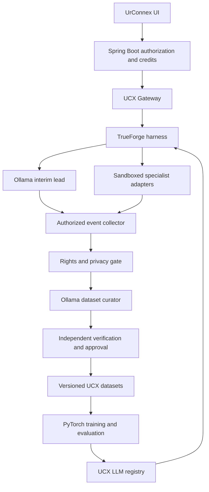

# UCX AI — Engineering, Dataset and LLM Roadmap

**Status:** Proposed architecture | **Target:** Debian 12 GPU VPS | **Revision:** 0.1

## 1. Mission and boundaries

Build an independent AI service shared by UrConnex and ForgeRoom. TrueForge is the candidate permanent harness; Ollama serves the interim lead and dataset-curation models; Codex, Claude Code and Antigravity are optional specialist adapters. The eventual UCX LLM is developed in Python/PyTorch and replaces the interim lead only after evaluation. Keep Pulse and unrelated projects out of this service. Do not train on public user conversations by default.



TrueForge compatibility, licensing and deployment interfaces must be verified against a pinned upstream release. If unsuitable, retain the gateway contract and substitute a minimal harness. Ollama does not train model weights during inference. Never assume that rewriting commercial agent outputs makes them eligible for training.

## 2. VPS deployment runbook

Target allocation: RTX 4000 Ada (expected 20 GB VRAM), 32 GB RAM, 8 vCPU, Apache2, existing UrConnex services. Verify actual capacity. Commands assume an authorized SSH administrator. Run sequentially, stop on failure. Do not restart existing application services or change firewall rules blindly.

### Step A — Read-only preflight

```bash
uname -r
cat /etc/os-release
nvidia-smi
free -h
df -h
systemctl --failed
sudo apache2ctl configtest
systemctl is-active apache2
sudo ss -lntp
command -v ollama node npm python3 codex claude agy
```

If NVIDIA fails, complete driver installation and validate matching kernel headers/DKMS before proceeding. Do not install a second driver over a working driver. Record baseline CPU, RAM, GPU and application health. Confirm backups and recovery procedure.

### Step B — Ollama

If not already installed, download and inspect the official installer:

```bash
curl -fsSL https://ollama.com/install.sh -o /tmp/ollama-install.sh
less /tmp/ollama-install.sh
sh /tmp/ollama-install.sh
sudo systemctl enable --now ollama
sudo systemctl edit ollama
```

Add a systemd override:

```ini
[Service]
Environment="OLLAMA_HOST=127.0.0.1:11434"
Environment="OLLAMA_NUM_PARALLEL=1"
Environment="OLLAMA_MAX_LOADED_MODELS=1"
Environment="OLLAMA_CONTEXT_LENGTH=8192"
Environment="OLLAMA_KEEP_ALIVE=2m"
```

```bash
sudo systemctl daemon-reload
sudo systemctl restart ollama
ollama pull qwen3:14b
ollama run qwen3:14b 'Return a short engineering task plan.'
ollama ps
nvidia-smi
curl -fsS http://127.0.0.1:11434/api/tags
```

Benchmark 8B versus 14B if necessary. Record latency, tokens/sec, VRAM, tool-call accuracy and application impact. Model tag availability and licensing must be checked before adoption. Start at 8K context, increase only after measurements. No public Ollama port.

Create two Modelfiles using the same base model, with distinct SYSTEM instructions: lead engineer plans, delegates and checks evidence; dataset engineer extracts structured examples only from eligible inputs, marks uncertainty and never invents tests or rights. Use `ollama create ucx-lead -f Modelfile.lead` and `ollama create ucx-curator -f Modelfile.curator`. Serialize workloads to avoid competing GPU allocations.

### Step C — Independent workspace and Python

```bash
sudo apt-get -s install git python3-venv python3-pip
# Review simulated changes before installing:
sudo apt-get install git python3-venv python3-pip
sudo adduser --system --group --home /opt/ucx-ai ucxai
sudo install -d -o ucxai -g ucxai -m 0750 /opt/ucx-ai /var/lib/ucx-ai
sudo -u ucxai python3 -m venv /opt/ucx-ai/.venv
sudo -u ucxai /opt/ucx-ai/.venv/bin/python -m pip install --upgrade pip
sudo -u ucxai /opt/ucx-ai/.venv/bin/pip install fastapi uvicorn httpx pydantic sqlalchemy 'psycopg[binary]' datasets pyarrow pytest
```

These are bootstrap dependencies; resolve and lock tested versions before production. Keep the service account unprivileged; it must not inherit administrator CLI credentials. Store secrets outside Git in restricted files or a secrets manager. Create a separate training virtual environment later; use the official PyTorch selector for the CUDA-compatible wheel (https://pytorch.org/get-started/locally/). Verify `torch.cuda.is_available()` and device name. Do not install a CUDA toolkit merely to run prebuilt wheels.

### Step D — TrueForge private evaluation

Candidate upstream: https://github.com/truefoundry/trueforge . Verify repository ownership, licence, release, package name, Node requirements, API documentation and security model before executing anything. Clone into an isolated evaluation workspace and pin a reviewed commit. If upstream confirms the npm package, inspect it with `npm view @truefoundry/trueforge version engines repository` and launch the reviewed version using `npx @truefoundry/trueforge@<verified-version>` (replace placeholder). Follow upstream configuration for localhost binding; do not assume flags or environment variable names. If localhost binding cannot be enforced, stop and isolate the evaluation environment.

Configure an OpenAI-compatible provider if supported: base URL `http://127.0.0.1:11434/v1`, model `ucx-lead`, local placeholder key if required. Verify streaming, structured tools, MCP, session isolation, approval hooks and event export. Do not expose the evaluation UI via Apache. Use SSH port forwarding to the verified local port if needed. Confirm production authentication, PostgreSQL/Redis requirements and API compatibility before promotion.

### Step E — Specialist adapters

Inventory `codex --version`, `claude --version`, `agy --version` and each CLI's `--help`. Validate supported noninteractive invocation in a disposable repository, with authorized credentials and provider-approved usage. Typical patterns: `codex exec`, `claude -p`, `agy -p`; exact flags and output formats depend on installed versions. Antigravity's earlier location error must be resolved legitimately; mark it unavailable until verified. Never bypass provider restrictions.

Implement adapters using subprocess argument arrays, no shell interpolation, restricted environment, bounded output, timeout, cancellation and structured events. Run each job in a separate sandbox with an isolated checkout, restricted network and no production secrets. Git worktrees alone are not security boundaries. Do not run untrusted public tasks on the production host without strong isolation; prefer separate workers/VMs. Human approval for merges, deployment and destructive operations.

### Step F — Storage and services

Use a separate PostgreSQL database and least-privilege role, not the UrConnex application database. Add pgvector only after checking compatibility with installed PostgreSQL; it is for retrieval, not required for training. Use JSONL/Parquet for approved training exports and encrypted restricted storage for eligible raw events. Redis is optional until a verified harness or queue requires it. Set retention, disk quotas and backup/restore tests. Never put raw traces, secrets, checkpoints or private datasets into Git.

After implementation, run the gateway as `ucxai` via systemd, bind to localhost (proposed port 8095, check availability), use `NoNewPrivileges=true`, `PrivateTmp=true`, `ProtectSystem=strict`, `ProtectHome=true`, explicit writable paths and tested memory/CPU limits. Keep agent workers separate from the gateway. Spring Boot calls the gateway using service authentication; browser clients never access Ollama, TrueForge or CLI workers directly. Use authenticated SSE for progress and cancellation. Apache changes require configtest and approved reload. No public exposure until security acceptance.

## 3. Dataset design and governance

Capture only authorized observable task inputs, tool events, diffs, tests, reviews and outcomes. Never capture hidden reasoning, credentials or unrelated user messages. Rights gate must precede model curation and training export; default deny when provider terms or ownership are uncertain. Maintain a provider/model/version-specific rights register. Commercial agent output, including transformed or derived examples, must not enter training without explicit applicable permission. Separate operational audit records from training records; even operational capture must comply with provider terms and privacy policy. Prefer human-authored examples, compatible open datasets and permitted synthetic data. Keep tenant data separate and require explicit authorization for training use.

Example schema (illustrative; not an approved record):

```json
{"id":"example-001","task":"debugging","instruction":"Fix a failing test","context_ref":"fixture-001","actions":[],"expected_output":null,"verification":{"status":"not_run","evidence":[]},"provenance":{"source":"human-authored fixture","license":null,"training_rights":"pending"},"split_group":"fixture-family-001","approval":"quarantine"}
```

Pipeline: eligible capture → secret/PII filtering → schema validation → Ollama extraction → deterministic tests → deduplication → independent review → rights approval → immutable release. Record hashes, source lineage, model version, prompt version and evaluator version. Separate train/validation/test by repository or task family before augmentation; prevent near-duplicate leakage. Preserve failed attempts as labelled negatives, not desired answers. Build instruction-response, tool-use trajectories and preference pairs as separate formats. Dataset release manifest must include counts, token statistics, rights, exclusions, checksums and split definitions. Allow revocation and retraining impact assessment.

## 4. Milestone roadmap

Estimates are planning ranges for one developer with agent assistance, not commitments. M1–M7 can overlap with experimental model research; production launch depends on security and evaluation gates.

| Milestone | Estimate | Deliverable and exit gate |
|---|---|---|
| M0 Infrastructure and governance | 1–2 days | Baseline, backup, rights register, isolation plan; no production regression |
| M1 Ollama GPU foundation | 1–2 days | Local inference, two roles, measured GPU and tool-call benchmark |
| M2 Harness proof of concept | 2–4 days | Pinned TrueForge, private sessions, MCP, streaming and approvals verified |
| M3 Specialist gateway | 3–7 days | Sandboxed adapters, cancellation, timeout, fallback and audit tests |
| M4 Event collection | 3–5 days | Structured events, retention, redaction, provenance and tenant tests |
| M5 DataForge | 1–2 weeks | Curator, rights gate, validators, deduplication and review queue |
| M6 Dataset v0.1 | 1–2 weeks | Initial target 100–1000 approved examples, manifest and held-out benchmark |
| M7 Training foundation | 1–2 weeks | Reproducible PyTorch environment, tokenizer, tiny transformer and checkpoint resume |
| M8 Practical UCX model | 2–4 weeks | Licensed 3B–7B base, QLoRA experiment, baseline comparison and model card |
| M9 UCX provider integration | 1–2 weeks | OpenAI-compatible inference or supported runtime, shadow tests, rollback |
| M10 Internal pilot | 2–4 weeks | Admin-only workflows, measured correctness, cost and reliability |
| M11 Public UrConnex integration | 2–4 weeks | Tenant isolation, credits, abuse limits, consent, SSE, security review |
| M12 ForgeRoom integration | Separate scope | Shared API, product-specific permissions and tools |
| M13 Continuous improvement | Ongoing | Versioned datasets, periodic offline training, evaluation and human promotion |

## 5. Training strategy

Track A: practical model using a licensed open-weight base, start with 3B–7B QLoRA, short sequences, gradient accumulation and checkpointing. Track B: independent PyTorch transformer, begin with a tiny model (e.g. 10–50M parameters) to verify tokenizer, causal attention, training loss, checkpointing and inference. Pretraining requires broad licensed corpora, not just engineering traces. Do not expect frontier-level capability from a single GPU. Training and production inference must not compete; schedule maintenance windows or use separate training compute. Install Transformers, PEFT, Accelerate and TRL in the training environment only after selecting compatible pinned versions. Track experiments with MLflow or equivalent; store datasets with versioned manifests/DVC if appropriate.

Evaluate task success, test pass rate, tool-call validity, security violations, hallucinated execution, latency and cost against the unchanged base and interim lead. Use independent held-out tasks and human review. Require zero critical security failures on the release suite; define numerical quality thresholds before training. Promote only after passing gates, with canary rollout and immediate rollback to the prior model. No automatic online weight updates.

## 6. Repository layout

```text
ucx-ai/
  gateway/           # FastAPI contracts and service auth
  harness/           # pinned TrueForge integration
  adapters/          # specialist and local providers
  collectors/        # eligible observable events
  dataforge/         # rights, curation, validation, export
  training/          # PyTorch, SFT, QLoRA
  ucx_llm/           # independent tokenizer and transformer
  evaluation/        # held-out fixtures and metrics
  infrastructure/    # systemd, deployment and monitoring
  docs/              # ADRs, reports, model and dataset cards
  tests/
```

Keep large artifacts outside repository. Proposed gateway endpoints: POST /v1/tasks, GET /v1/tasks/{id}, GET /v1/tasks/{id}/events, POST /v1/tasks/{id}/cancel, POST /v1/tasks/{id}/approval. Enforce authorization on every resource and event stream. Separate internal engineering from public assistant workflows.

## 7. First implementation assignment (Codex or Claude)

Execute M0–M1 only. Audit VPS and GPU; preserve existing UrConnex and Apache services. Confirm backups, disk space and current workloads. Install Ollama only if absent, bind localhost, limit concurrency, benchmark one local model and configure lead/curator roles. Create the independent project skeleton and a proposed rights register. Produce `docs/M0-infrastructure-audit.md`, `docs/M1-ollama-benchmark.md` and `docs/architecture.md`. Record actual commands, measured results and blockers without secrets. Do not install TrueForge until upstream compatibility is reviewed; do not train, expose public endpoints, change production databases, or deploy specialist workers. Stop at the M1 acceptance gate for human review.

## 8. Operational references

- Ollama: https://ollama.com/ and https://docs.ollama.com/
- Candidate harness: https://github.com/truefoundry/trueforge
- PyTorch: https://pytorch.org/get-started/locally/
- Hugging Face: https://huggingface.co/docs
- MCP: https://modelcontextprotocol.io/

These are reference entry points; verify current installation commands, versions and terms before executing deployment steps.
