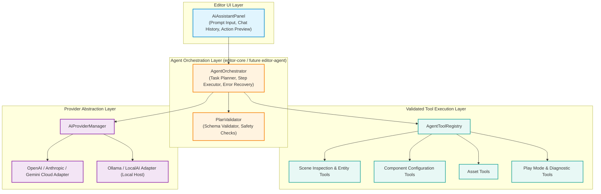

# GdxUnity AI Agent Architecture Audit and Implementation Roadmap

**Project:** GdxUnity  
**Document:** `docs/AI_AGENT_ARCHITECTURE_AUDIT.md`  
**Companion Report:** `docs/PHASE_9_ARCHITECTURE_AUDIT.md`  
**Vision Document:** `docs/ALL_IN_ONE_STUDIO_ROADMAP.md`  
**Audit Date:** October 2024 (Verified against active repository baseline)  
**Technology Stack:** Java 21 LTS | LibGDX 1.14.2 | LWJGL3 3.4.1 | Gradle Wrapper 9.6.1 | JUnit Jupiter 5.10.0  
**AI Target Preference:** Hybrid Local (Ollama/LM Studio/LocalAI) & Cloud Providers (OpenAI, Anthropic, Gemini)  
**First Target AI Vertical Slice:** A playable 2D platform game with player movement, jumping, collisions, and a goal  
**Status:** Audit & Architecture Completed — READ-ONLY mode, awaiting approval gate  

---

## 1. Executive Summary

GdxUnity's long-term vision combines a 2D/3D game engine and visual editor with dedicated creative studios (Vector, Audio, 3D modeling) and a built-in, first-class **AI Agent**. The agent's mission is to empower creators to describe games, scenes, and mechanics in natural language and have the engine inspect, plan, generate, validate, run, and refine playable games directly inside the editor.

### Key Architectural Tenet
**The AI Agent is an Editor Capability, Never a Runtime Dependency.**  
The agent must not be a superficial, detached chatbot that merely spits out disconnected Markdown snippets. It must operate directly upon the GdxUnity project through **typed, validated editor tools, commands, and scene APIs**, while engine runtime modules (`engine-core`, `engine-scene`, `engine-render`, `engine-desktop`) remain 100% agnostic to AI SDKs, LLM wire protocols, or cloud endpoints.

### First Playable 2D Game Benchmark Prompt
> *"Create a simple 2D platform game. Add a player character, a ground platform, several floating platforms, and a goal. Let the player move left and right, jump, collide with platforms, and reach the goal to win."*

---

## 2. Verified Engine & Editor Readiness

An exhaustive verification of the active codebase was performed to determine readiness for the AI agent:

### 2.1 Ready & Reusable Subsystems
1. **Scene Graph & Entity Architecture (`engine-scene`)**:
   - `Entity`, `Transform`, `Component`, `Scene`: Full UUID stability, parent-child hierarchies, and world matrix calculations.
   - Reusable for agent entity generation and spatial layouts.
2. **Versioned Scene Serialization (`engine-scene`)**:
   - `SceneSerializer` (Schema version 1), `ComponentSerializer`, `ComponentSerializerRegistry`.
   - Complete JSON serialization of scene structures and components (`ShapeRendererComponent`, `SpriteRendererComponent`, `EntityScriptBindingComponent`).
   - Ideal for agent scene inspection, snapshotting, and transaction rollbacks.
3. **Command & Undo/Redo Architecture (`editor-core`)**:
   - `EditorCommand`, `CommandHistory`: Concrete reversible commands exist for `CreateEntityCommand`, `DeleteEntityCommand`, `ChangeTransformCommand`, `AssignSpriteAssetCommand`, `AddComponentCommand`, `RenameEntityCommand`, `ChangeEntityActiveCommand`.
   - Allows agent modifications to be batched into `CompoundCommand` and undone by the user with standard `Ctrl+Z`.
4. **Play Mode Isolation (`editor-core`)**:
   - `PlayModeController`: Headless-tested Play/Pause/Stop state machine that clones the authored scene via JSON serialization before simulation.
   - Prevents AI-generated runtime gameplay tests from corrupting authored editor state.
5. **Polyglot Scripting Foundation (Milestone 9)**:
   - `ScriptComponent`, `EntityScriptBindingComponent`, `JavaScriptCompiler`, `KotlinScriptCompiler`, `ScriptManager`.
   - Provides runtime dynamic compilation of Java and Kotlin scripts with structured error diagnostics (`ScriptDiagnostic`).
6. **Headless Verification Prowess**:
   - 101 tests across 22 suites running headlessly under JUnit 5 in 31.5 seconds with zero failures.

---

## 3. Missing Capabilities for the First Playable 2D Game

While the engine baseline is mature, a strict audit of the codebase reveals that **2D collision and platformer physics are currently missing**:

| Required Gameplay Feature | Baseline State | Gap Analysis & Minimal Required Solution |
| :--- | :--- | :--- |
| **Player Horizontal Movement** | Partially feasible via `ScriptComponent` | Supported via `ScriptComponent.onUpdate()` or a dedicated `CharacterController2DComponent`. |
| **Jumping & Gravity** | Missing | No gravity accumulator, velocity vector, or jump state machine currently exists in `engine-scene`. |
| **Ground & Platform Collisions** | **Missing** | No collision detection, AABB intersection, or Box2D physics currently exists in the codebase. Entities have transforms and visual bounds, but no physical colliders. |
| **Goal / Win Condition** | Missing | No trigger volume, overlap detector, or game-state victory manager exists. |

### Minimum Viable Gameplay Strategy (Phase 9D)
To satisfy the first AI prompt without importing a massive external physics engine prematurely:
1. **Option A: Minimal Lightweight AABB Physics Components (`engine-scene`)**:
   - Introduce `BoxCollider2DComponent` (width, height, offset, isTrigger).
   - Introduce `SimpleKinematicBody2DComponent` (velocity, gravityScale, isGrounded, jumpForce).
   - Introduce `TriggerGoal2DComponent` (targetEntityId, onTriggerEvent).
   - Execute a minimal discrete AABB resolution step inside `engine-scene` during Play Mode.
2. **Option B: Java Script Implementation (`ScriptComponent`)**:
   - Author a standalone `PlayerPlatformerScript.java` utilizing entity bounds. However, without colliders, the script would have to hardcode platform coordinates.
3. **Recommendation**: Implement **Option A** as first-class, lightweight, serializable Java components in `engine-scene`. This gives the AI agent inspectable, typed properties (`jumpVelocity`, `gravity`, `colliderSize`) that it can tune via natural language prompts!

---

## 4. Proposed AI Agent Architecture

The AI agent architecture is structured into 4 decoupled layers:



### 4.1 AI Interaction Panel (`AiAssistantPanel`)
- Embedded as an optional tab in the `editor-desktop` workspace shell.
- Features:
  - **Prompt Input & Chat Thread**: Natural-language instruction entry.
  - **Structured Action Preview**: Displays planned entity creations, transform positions, and component attachments *before* applying them.
  - **Execution Controls**: "Apply Changes", "Reject / Cancel", "Undo Agent Step".
  - **Diagnostics Feedback**: Shows compiler warnings, play-mode runtime exceptions, or missing references.
  - **Provider Switcher**: Quick toggle between Cloud (e.g. OpenAI GPT-4o, Anthropic Claude 3.5 Sonnet, Google Gemini 1.5 Pro) and Local (e.g. Ollama `llama3.2` / `qwen2.5-coder`).

### 4.2 Agent Orchestrator (`AgentOrchestrator`)
- Coordinates the plan-validate-execute loop:
  1. **Project & Scene Reflection**: Formats current scene entities, existing components, and available asset catalogs into a compact system context prompt.
  2. **Plan Synthesis**: Requests a structured JSON plan from the configured `AiModelProvider`.
  3. **Pre-Execution Validation**: `PlanValidator` verifies tool names, argument schemas, entity UUIDs, and safe parameter bounds.
  4. **Transactional Execution**: Wraps all tool actions into a single `CompoundCommand` executed via `EditorState.executeCommand()`.
  5. **Verification & Diagnostics**: Prompts Play Mode execution or compiles scripts, capturing any `ScriptDiagnostic` or runtime logs.
  6. **Iterative Refinement**: Feeds errors back to the model for bounded, self-correcting repairs (capped at 3 iterations).

---

## 5. Provider-Neutral Model Integration (Hybrid Architecture)

### 5.1 Hybrid Strategy & Trade-Offs

| Provider Type | Examples | Advantages | Limitations & Trade-Offs |
| :--- | :--- | :--- | :--- |
| **Cloud Providers** | OpenAI, Anthropic, Google Gemini | State-of-the-art spatial reasoning, massive context windows, superior JSON/Tool-calling fidelity. | Requires API key, internet connectivity, token costs, sends project metadata over network. |
| **Local Providers** | Ollama, LM Studio, LocalAI (`localhost:11434`) | 100% private, zero cost, completely offline, operates in air-gapped environments. | High RAM/VRAM requirements, smaller context, occasional JSON formatting hallucinations. |

### 5.2 Provider-Neutral Contract Design (`editor-core`)
```java
package io.github.ldev22live.gdxunity.editor.core.ai.provider;

import java.util.concurrent.CompletableFuture;

public interface AiModelProvider {
    String getProviderId();       // e.g. "ollama", "openai", "anthropic"
    String getDisplayName();
    boolean isAvailable();        // ping endpoint / verify API key
    
    CompletableFuture<AiResponse> generateCompletion(AiRequest request);
    CompletableFuture<AiPlanResponse> generatePlan(AiPlanRequest request);
}
```

**Zero Production SDK Lock-In**: Use standard Java 21 `java.net.http.HttpClient` with `CompletableFuture` for HTTP REST/JSON communications. No bloated third-party vendor SDKs are added to the Gradle dependencies.

---

## 6. Validated Editor Tool Layer & Structured Plan Schema

To maintain complete security and stability, the agent communicates exclusively via typed tools. **No arbitrary shell execution, reflection, or raw file system access is permitted.**

### 6.1 Tool Inventory Table

| Tool Name | Parameters | Responsibility | Reversible Command Used |
| :--- | :--- | :--- | :--- |
| `scene_inspect` | `includeComponents: boolean` | Returns JSON representation of active scene hierarchy. | *Read-only* |
| `entity_create` | `name: string, posX, posY, posZ` | Spawns a new entity with local transform. | `CreateEntityCommand` |
| `entity_delete` | `entityId: UUID` | Deletes an entity and preserves hierarchy. | `DeleteEntityCommand` |
| `transform_set` | `entityId: UUID, posX, posY, rotZ, scaleX, scaleY` | Updates local transform properties. | `ChangeTransformCommand` |
| `component_add` | `entityId: UUID, componentType: string, properties: Map` | Adds a typed component (ShapeRenderer, Sprite, Collider). | `AddComponentCommand` |
| `playmode_test` | `durationSeconds: float` | Runs simulation headlessly or in editor, returning diagnostics. | `PlayModeController` |
| `script_attach` | `entityId: UUID, scriptPath: string` | Attaches a Java/Kotlin script binding. | `AddComponentCommand` |

### 6.2 Structured Plan Schema (`plan.json`)
The LLM generates a versioned, validated JSON structure:
```json
{
  "version": 1,
  "summary": "Generate 2D Platformer Level with Ground, Jump Platforms, Player and Goal",
  "steps": [
    {
      "stepId": "create_player",
      "tool": "entity_create",
      "parameters": { "name": "Player", "posX": 100.0, "posY": 150.0, "posZ": 0.0 }
    },
    {
      "stepId": "add_player_render",
      "tool": "component_add",
      "parameters": {
        "entityId": "$ref:create_player.id",
        "componentType": "ShapeRendererComponent",
        "properties": { "width": 32.0, "height": 48.0, "color": "#00AAFF" }
      }
    },
    {
      "stepId": "add_player_physics",
      "tool": "component_add",
      "parameters": {
        "entityId": "$ref:create_player.id",
        "componentType": "SimpleKinematicBody2DComponent",
        "properties": { "gravity": -980.0, "jumpForce": 450.0, "moveSpeed": 200.0 }
      }
    },
    {
      "stepId": "create_ground",
      "tool": "entity_create",
      "parameters": { "name": "GroundPlatform", "posX": 320.0, "posY": 30.0, "posZ": 0.0 }
    },
    {
      "stepId": "add_ground_collider",
      "tool": "component_add",
      "parameters": {
        "entityId": "$ref:create_ground.id",
        "componentType": "BoxCollider2DComponent",
        "properties": { "width": 640.0, "height": 40.0, "isTrigger": false }
      }
    },
    {
      "stepId": "create_goal",
      "tool": "entity_create",
      "parameters": { "name": "LevelGoal", "posX": 580.0, "posY": 280.0, "posZ": 0.0 }
    }
  ]
}
```

---

## 7. Security, Privacy, and Operational Reliability

1. **Project Directory Sandboxing**: All asset and script manipulations are validated to ensure canonical paths reside strictly within the project folder. Path traversal (`../`) is blocked.
2. **Credential Security**: API keys for cloud providers are stored in OS-level user preferences (`Preferences` / secure storage) and never written into project files or committed to Git.
3. **Context Minimization**: Only the structural summary of the active scene and registered asset catalog metadata are transmitted to the LLM. Personal environment variables or system paths are excluded.
4. **Execution Safety Boundaries**:
   - Model outputs are treated as **untrusted data**.
   - Scripts are compiled in an isolated `URLClassLoader` without arbitrary system execution privileges.
   - Play Mode simulations are protected by existing scene isolation (scene JSON cloning).
5. **Human-in-the-Loop Approval**:
   - The user must explicitly approve high-impact actions (deleting multiple entities, overwriting scripts) unless "Auto-Apply" is explicitly toggled by the user.
   - All agent operations are reversible via standard Undo (`Ctrl+Z`).

---

## 8. Shared Creative-Platform Prerequisites

| Capability | Current State | Requirement for AI & Studios |
| :--- | :--- | :--- |
| **Project & Asset Identity** | Verified (`AssetReference`, `AssetType`, `AssetCatalog`) | Stable references ensure AI can attach textures and sounds without broken paths. |
| **Compound Commands** | Missing (single commands exist) | Implement `CompoundCommand` in `editor-core` to group multi-step AI plans into 1 undo step. |
| **Serialization Migration** | Verified (`SceneSerializer` schema v1) | Ensure AI-generated component fields serialize safely. |
| **Compiler & Runtime Diagnostics** | Verified (`ScriptManager`, `ScriptDiagnostic`) | Diagnostics feed directly back into the AI orchestrator for autonomous bug fixing. |

---

## 9. Integrated Dependency-Aware Implementation Roadmap

The implementation roadmap harmoniously unifies the Phase 9 workspace architecture with the AI-assisted game vertical slice:

```
┌────────────────────────────────────────────────────────────────────────────────┐
│                           INTEGRATED ROADMAP TIMELINE                          │
├────────────────────────────────────────────────────────────────────────────────┤
│ Phase 9A: Unified Workspace Foundations (Docking, Multi-Select, Shortcuts)     │
│       │                                                                        │
│       ▼                                                                        │
│ Phase 9B: AI Tool Contracts & Structured Plan Engine                           │
│       │                                                                        │
│       ▼                                                                        │
│ Phase 9C: Hybrid Provider Foundation (Ollama Local + Cloud HTTP Adapters)       │
│       │                                                                        │
│       ▼                                                                        │
│ Phase 9D: 2D Platformer Physics Primitives (Colliders, Kinematics, Goal)       │
│       │                                                                        │
│       ▼                                                                        │
│ Phase 9E: First AI-Assisted Playable Game (End-to-End Vertical Slice)          │
│       │                                                                        │
│       ▼                                                                        │
│ Phase 10: Vector Art Studio  ──►  Phase 11: Audio DAW  ──►  Phases 12-14: 3D   │
└────────────────────────────────────────────────────────────────────────────────┘
```

### Detailed Phase Specifications

#### Phase 9A — Unified Workspace Foundations (Immediate Prerequisite)
- **Scope**: Multi-entity selection in `EditorState`, `StudioWorkspace` & `WorkspaceManager` in `editor-core`, centralized keyboard shortcut dispatcher, and pure `scene2d.ui` split-pane docking in `editor-desktop`.
- **Exit Criterion**: Clean Gradle build, $\ge 115$ passing tests, existing 2D scene editor operates inside docking shell.

#### Phase 9B — AI Tool Contracts & Structured Plan Engine
- **Scope**: Define `AgentTool`, `AgentToolRegistry`, `PlanValidator`, and `CompoundCommand` in `editor-core`.
- **Exit Criterion**: Deterministic unit tests apply structured JSON plans to a headless scene without calling an external model.

#### Phase 9C — Hybrid Provider Foundation
- **Scope**: Implement `AiModelProvider`, `OllamaLocalProvider` (`localhost:11434`), and `OpenAiCloudProvider` using Java 21 `HttpClient`.
- **Exit Criterion**: Mocked/live provider integration tests verify structured plan parsing and graceful handling of timeouts/rate-limits.

#### Phase 9D — Minimum Playable 2D Game Capability
- **Scope**: Implement `BoxCollider2DComponent`, `SimpleKinematicBody2DComponent`, and `TriggerGoal2DComponent` in `engine-scene`. Add discrete AABB collision loop in Play Mode.
- **Exit Criterion**: A manually authored 2D platformer scene runs in Play Mode, with player jumping, colliding with platforms, and reaching the goal.

#### Phase 9E — First AI-Assisted Playable Game (Vertical Slice)
- **Scope**: Embed `AiAssistantPanel` into the `editor-desktop` workspace shell. Connect prompt input $\rightarrow$ provider $\rightarrow$ validated plan $\rightarrow$ tool execution $\rightarrow$ Play Mode run.
- **Exit Criterion**: User inputs the target prompt; the agent creates the player, platforms, colliders, and goal; user hits Play and successfully plays the game.

---

## 10. Acceptance & Quality Strategy

### 10.1 Automated Headless Tests
1. **Plan Validation Tests**: Verify that invalid tool names, negative platform sizes, or malformed JSON plans are rejected with descriptive errors.
2. **Compound Undo/Redo Tests**: Verify that executing a 10-step AI game generation plan can be completely undone in a single `Ctrl+Z` action, restoring the pristine scene.
3. **Collision Detection Unit Tests**: Verify AABB box intersection, ground contact detection, and jump velocity clamping.
4. **Provider Error Handling Tests**: Verify that provider 500 errors, network timeouts, or invalid API keys do not hang the UI or crash the engine.

### 10.2 Manual Graphical Verification
1. Launch `./gradlew.bat :editor-desktop:run`.
2. Open the AI Assistant tab.
3. Enter the platformer prompt.
4. Review the structured action preview.
5. Click "Apply Plan". Watch the Hierarchy and Scene View populate with Player, Ground, Platforms, and Goal entities.
6. Click Play Mode. Control the player character with arrow keys / Space to jump. Reach the goal and observe the win status.

---

## 11. Approval Gate & Recommended Next Implementation Prompt

### Decisions Requiring Approval
- [ ] **Approval Decision 1**: Approve keeping the 6 existing modules for Phase 9A, implementing AI tool abstractions within `editor-core`.
- [ ] **Approval Decision 2**: Approve the hybrid provider strategy (local Ollama + cloud HTTP) using pure Java 21 `HttpClient` without external SDKs.
- [ ] **Approval Decision 3**: Approve adding minimal 2D kinematic/collider components to `engine-scene` in Phase 9D to support the platformer benchmark.
- [ ] **Approval Decision 4**: Approve the integrated roadmap sequence (Phase 9A $\rightarrow$ 9B $\rightarrow$ 9C $\rightarrow$ 9D $\rightarrow$ 9E).
- [ ] **Approval Decision 5**: Authorize beginning implementation of **Phase 9A: Unified Workspace Foundations**.

### Recommended Next Windsurf Implementation Prompt
Upon approval, execute the following prompt:
```text
# Windsurf Prompt — GdxUnity Phase 9A: Unified Workspace Foundations Implementation

Implement Phase 9A according to the approved architecture in docs/PHASE_9_ARCHITECTURE_AUDIT.md:
1. Upgrade EditorState to support multi-entity selection (LinkedHashSet<UUID>) with full backward compatibility for existing single-selection methods.
2. Implement StudioWorkspace and WorkspaceManager contracts in editor-core with full lifecycle transitions.
3. Implement EditorKeyboardDispatcher in editor-core to prevent shortcut leakage during text-field focus.
4. Refactor EditorApplication in editor-desktop to use resizable scene2d.ui split-panes and StudioNavigationBar hosting SceneEditorWorkspace.
5. Implement WorkspaceLayoutSerializer for versioned layout.json persistence with safe default recovery.
6. Ensure all 101 existing tests continue to pass and add comprehensive unit tests for multi-selection, workspace switching, and layout persistence.
```

---
*End of AI Agent Architecture Audit Report. Ready for review and approval.*
