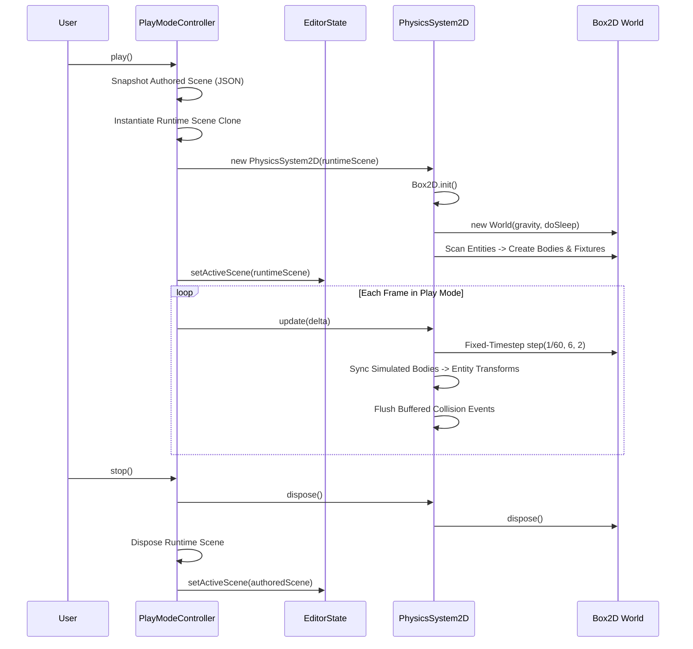

# GdxUnity Phase 10A — 2D Physics Architecture and Integration Design

**Project:** GdxUnity  
**Phase:** 10A — Physics Architecture and Integration Design  
**Date:** October 24, 2026  
**Technology:** Java 21 LTS, LibGDX 1.14.2, Gradle 9.6.1 multi-project build  
**Operating System:** Windows 11  
**Status:** **APPROVED DESIGN & ARCHITECTURAL BASELINE**

---

## 1. Executive Summary

Phase 10A establishes the architectural foundations and integration design for incorporating 2D rigid-body physics and collision detection into GdxUnity without disrupting its existing scene model, serialization format, play-mode snapshot isolation, or headless testing pipeline.

Following the design principles established in Phases 0–9E:
1. **Scene Decoupling:** Physics components (`RigidBody2DComponent`, `BoxCollider2DComponent`, `CircleCollider2DComponent`) represent pure authored scene data and configuration. They do NOT hold or serialize native pointers, Box2D `Body`, or `Fixture` handles.
2. **Explicit Runtime Ownership:** A dedicated `PhysicsSystem2D` owns the lifecycle of the LibGDX `com.badlogic.gdx.physics.box2d.World`. It is instantiated strictly upon entering Play mode and completely disposed upon returning to Edit mode.
3. **Deterministic Stepping:** A fixed-timestep accumulator decouples variable frame rendering ($\Delta t_{render}$) from simulation ($\Delta t_{fixed} = \frac{1}{60}\text{ s}$), clamping frame deltas to protect against the "spiral of death."
4. **Collision Event Queue:** Native Box2D `ContactListener` callbacks buffer raw collision events into a thread-safe / lock-safe queue, dispatched to entity scripts and editor diagnostics only outside Box2D's internal world-lock phase.
5. **Coordinate Boundary:** An explicit conversion scale ($\text{PPU} = 100 \text{ pixels per meter}$) bridges GdxUnity's 2D world pixel space and Box2D's MKS (Meter-Kilogram-Second) unit system.

---

## 2. Verified Repository Baseline

### 2.1 Git Audit
- **Branch:** `main` (commit `9e10de6`)
- **Working Tree:** All user modifications, unstaged build scripts, and docs are preserved intact.

### 2.2 Subproject Test Counts (Pre-Phase 10 Baseline)
| Module | Role | Test Count | Status |
| :--- | :--- | :---: | :---: |
| `editor-core` | Commands, history, selection, play mode, AI tools | **132** | **PASS** |
| `editor-desktop` | Desktop UI shell, panels, layout recovery, integration tests | **3** | **PASS** |
| `engine-core` | Primitives, asset catalog, frame clock, engine lifecycle | **27** | **PASS** |
| `engine-render` | 2D camera, primitive rendering, sprite rendering, render components | **13** | **PASS** |
| `engine-scene` | Entities, transforms, scene hierarchy, scripting, serialization | **27** | **PASS** |
| `engine-desktop` | Desktop runtime launcher | NO-SOURCE | **PASS** |
| **Total** | Multi-project workspace build | **202** | **PASS** |

---

## 3. Physics Dependency Compatibility & Findings

### 3.1 Candidate Evaluation: Official LibGDX Box2D (`gdx-box2d`)
- **Compatibility:** Fully compatible with LibGDX `1.14.2` and Java 21 LTS.
- **Maven Coordinates:**
  - Core API: `com.badlogicgames.gdx:gdx-box2d:$gdxVersion`
  - Desktop Platform Natives: `com.badlogicgames.gdx:gdx-box2d-platform:$gdxVersion:natives-desktop`
- **Native Library Lifecycle:**
  - JNI bindings require loading native binaries (`.dll` on Windows, `.so` on Linux, `.dylib` on macOS).
  - Explicit initialization via `Box2D.init()` ensures natives are unpacked and loaded before any `World` or `Body` allocation.
- **Headless Testing:** Box2D can run headlessly (without OpenGL graphics context). Adding `natives-desktop` to test runtime classpaths allows 100% headless unit testing for physics steps, body creation, and collision math.
- **Debug Rendering:** LibGDX provides `com.badlogic.gdx.physics.box2d.Box2DDebugRenderer`, allowing direct debug wireframe rendering of colliders and center-of-mass vectors in desktop viewports.

### 3.2 Recommended Dependency Allocation per Gradle Module
```
[engine-core]
  └── (No physics dependencies)

[engine-scene]
  └── api "com.badlogicgames.gdx:gdx-box2d:$gdxVersion"
  └── testRuntimeOnly "com.badlogicgames.gdx:gdx-box2d-platform:$gdxVersion:natives-desktop"

[engine-render]
  └── (Depends on engine-scene; no direct native physics dependency needed)

[editor-core]
  └── (Depends on engine-scene; uses physics components for serializers & AI tools)
  └── testRuntimeOnly "com.badlogicgames.gdx:gdx-box2d-platform:$gdxVersion:natives-desktop"

[editor-desktop] / [engine-desktop]
  └── implementation "com.badlogicgames.gdx:gdx-box2d-platform:$gdxVersion:natives-desktop"
```

---

## 4. Proposed Physics Architecture & Component Design

```mermaid
graph TD
    subgraph Scene Model (Serialized & Authored)
        E[Entity]
        T[Transform]
        RB[RigidBody2DComponent]
        BC[BoxCollider2DComponent]
        CC[CircleCollider2DComponent]
        E --> T
        E --> RB
        E --> BC
        E --> CC
    end

    subgraph PlayMode Simulation (Runtime Only)
        PMC[PlayModeController]
        P2D[PhysicsSystem2D]
        W[Box2D World]
        B[Box2D Body]
        F1[Fixture: Box]
        F2[Fixture: Circle]

        PMC -->|1. Init on Play| P2D
        P2D -->|Owns| W
        W -->|Allocates| B
        B -->|Attaches| F1
        B -->|Attaches| F2
        P2D -->|2. Step & Sync| T
    end
```

### 4.1 `RigidBody2DComponent`
Authored component defining dynamic, kinematic, or static body characteristics.
- **Attributes:**
  - `BodyType bodyType` (`STATIC`, `KINEMATIC`, `DYNAMIC`) — default `DYNAMIC`.
  - `float gravityScale` — default `1.0f`.
  - `float linearDamping` — default `0.0f`.
  - `float angularDamping` — default `0.05f`.
  - `boolean fixedRotation` — default `false`.
  - `boolean bullet` — default `false` (continuous collision detection).
  - `Vector2 initialLinearVelocity` — default `(0, 0)`.
  - `float initialAngularVelocity` — default `0.0f`.
  - `boolean enabled` — default `true` (inherited from `BaseComponent`).
- **Serialization:** Pure JSON serialization of properties. No Box2D runtime pointers.

### 4.2 `BoxCollider2DComponent`
Defines an oriented bounding box fixture.
- **Attributes:**
  - `float width` — width in scene units (default matches entity renderer or `50f`).
  - `float height` — height in scene units (default matches entity renderer or `50f`).
  - `Vector2 offset` — local offset from entity transform origin (default `(0, 0)`).
  - `float density` — default `1.0f` ($\text{kg}/\text{m}^2$).
  - `float friction` — default `0.2f` ($[0, 1]$).
  - `float restitution` — bounciness, default `0.0f` ($[0, 1]$).
  - `boolean isSensor` — trigger/sensor flag, default `false`.
  - `short categoryBits` — collision filter category, default `0x0001`.
  - `short maskBits` — collision filter mask, default `(short) 0xFFFF`.

### 4.3 `CircleCollider2DComponent`
Defines a circular fixture.
- **Attributes:**
  - `float radius` — radius in scene units (default `25f`).
  - `Vector2 offset` — local offset from entity transform origin.
  - `float density`, `friction`, `restitution`, `isSensor`, `categoryBits`, `maskBits`.

### 4.4 Multiple Colliders per Entity
- **Design Decision:** In Phase 10B, GdxUnity will support **multiple collider components per entity**. Box2D natively supports multiple `Fixture`s attached to a single `Body`. The `PhysicsSystem2D` will bind all attached `Collider2D` components on an entity to that entity's single `Body`.

---

## 5. Coordinate & Transform Semantics

### 5.1 Units & Scale
- **GdxUnity Scene Units:** Pixels ($\text{px}$), where an entity typically has a size such as $50 \times 50$ or $128 \times 128$.
- **Box2D Physics Units:** Meters-Kilograms-Seconds (MKS), tuned for objects between $0.1\text{ m}$ and $10.0\text{ m}$. Direct pixel coordinates ($1000\text{ px}$) would destabilize Box2D's constraint solvers.
- **Conversion Factor:** **$\text{PPU} = 100.0\text{ pixels per meter}$** ($1\text{ m} = 100\text{ px}$).
  $$\vec{p}_{physics} = \frac{\vec{p}_{scene}}{100.0f}, \quad \vec{p}_{scene} = \vec{p}_{physics} \times 100.0f$$
  $$\text{size}_{physics} = \frac{\text{size}_{scene}}{100.0f}$$

### 5.2 Angular Representation
- **GdxUnity Scene:** Uses `Transform.getLocalRotation()` as a `Quaternion`, with 2D roll expressed in degrees around the Z-axis.
- **Box2D:** Expresses angle in **radians** counter-clockwise.
- **Conversion:**
  $$\theta_{physics} = \theta_{degrees} \times \left(\frac{\pi}{180.0f}\right)$$
  $$\theta_{degrees} = \theta_{physics} \times \left(\frac{180.0f}{\pi}\right)$$

### 5.3 Hierarchy and Scale Constraints
- **Root vs. Child Entities:** Box2D bodies operate in world space. When an entity has a parent, `PhysicsSystem2D` synchronizes world coordinates into Box2D at initialization and propagates simulated world coordinates back to local coordinates on update:
  $$\vec{p}_{local} = \mathbf{R}_{parent}^{-1} \cdot \left(\frac{\vec{p}_{world} - \vec{p}_{parent\_world}}{\vec{s}_{parent\_world}}\right)$$
- **Scale:** Negative or zero scale is rejected for colliders. Non-uniform scale scales box half-extents ($w \cdot s_x, h \cdot s_y$); circles require uniform scaling ($\max(s_x, s_y)$).

---

## 6. Runtime Ownership & Lifecycle



1. **Owner:** `PlayModeController` owns the single active `PhysicsSystem2D` instance.
2. **Creation:** Created upon `PlayModeController.play()`. Native bodies are constructed only for active entities in the cloned `runtimeScene`.
3. **Destruction:** When `PlayModeController.stop()` is called, `physicsSystem.dispose()` explicitly destroys all bodies and fixtures, closes the `World`, and sets references to null.
4. **Authored Scene Invariant:** Authored scenes in Edit mode never touch Box2D objects, ensuring total memory and state isolation.

---

## 7. Fixed-Timestep Accumulator Algorithm

To avoid frame-rate dependent physics glitches and the "spiral of death" during lag spikes:

```java
public class PhysicsSystem2D implements Disposable {
    private static final float FIXED_TIMESTEP = 1.0f / 60.0f; // 16.666 ms
    private static final int VELOCITY_ITERATIONS = 6;
    private static final int POSITION_ITERATIONS = 2;
    private static final int MAX_SUB_STEPS = 5;

    private float accumulator = 0.0f;
    private World world;

    public void update(float deltaTime) {
        // Clamp frame delta to 0.1s max to prevent spiral of death
        float frameTime = Math.min(deltaTime, 0.1f);
        accumulator += frameTime;

        int steps = 0;
        while (accumulator >= FIXED_TIMESTEP && steps < MAX_SUB_STEPS) {
            world.step(FIXED_TIMESTEP, VELOCITY_ITERATIONS, POSITION_ITERATIONS);
            accumulator -= FIXED_TIMESTEP;
            steps++;
        }

        // Synchronize simulated Box2D body positions back to Scene Entity Transforms
        syncBodiesToTransforms();

        // Dispatch queued collision callbacks outside Box2D internal lock
        dispatchQueuedCollisionEvents();
    }
}
```

---

## 8. Safe Collision Event Architecture

Direct scene mutation (such as creating/destroying entities or removing components) inside Box2D's internal `ContactListener` callback is illegal and causes native memory crashes due to Box2D's world lock.

### 8.1 Event Abstraction
Engine-level collision event records that decouple game logic from Box2D:
```java
public record Collision2D(
    Entity entity,
    Entity otherEntity,
    Component collider,
    Component otherCollider,
    Vector2 contactPoint,
    Vector2 normal,
    boolean isSensor
) {}
```

### 8.2 Safe Event Queue Flow
1. **Box2D Listener:** Listens to `beginContact(Contact contact)` and `endContact(Contact contact)`.
2. **Buffer Phase:** Extracts entity handles from `Fixture.getUserData()` and enqueues immutable `CollisionEvent` objects into a concurrent queue.
3. **Dispatch Phase:** After `world.step()` completes and the world lock is released, `PhysicsSystem2D` iterates the queue and invokes script callbacks:
   - `onCollisionEnter2D(Collision2D collision)`
   - `onCollisionExit2D(Collision2D collision)`
   - `onSensorEnter2D(Collision2D collision)`
   - `onSensorExit2D(Collision2D collision)`

---

## 9. Editor Integration & Viewport Diagnostics

1. **Component Registration:**
   - Add `RigidBody2DComponentSerializer`, `BoxCollider2DComponentSerializer`, and `CircleCollider2DComponentSerializer` to `SceneSerializer`.
   - Register Inspector property editors for RigidBody and Collider properties in `editor-desktop`.
2. **Debug Overlay:**
   - In Scene View, provide an editor toolbar toggle: `[#] Physics Wireframe`.
   - In Edit Mode: Draw collider outlines using `ShapeRenderer2D` based on authored collider properties.
   - In Play Mode: Utilize LibGDX's `Box2DDebugRenderer` to draw active physics shapes, sleeping states, and velocities.

---

## 10. Headless Testing Strategy for Phase 10B

- **Headless Unit Tests:**
  - `Box2D.init()` can be run headlessly in JUnit 5.
  - Test coordinate conversions (`toPhysicsCoords`, `toSceneCoords`).
  - Test body creation, gravity stepping, and collision event queueing without any display or window server.
- **Native Classpath Setup:**
  - Ensure `engine-scene` and `editor-core` test configurations include `testRuntimeOnly "com.badlogicgames.gdx:gdx-box2d-platform:$gdxVersion:natives-desktop"`.

---

## 11. Ordered Implementation Plan for Phase 10B

1. **Step 1 — Dependency Configuration:**
   - Add `gdx-box2d` to `engine-scene` and native classifiers to `editor-core`, `engine-desktop`, and `editor-desktop`.
2. **Step 2 — Component Data Model & Serialization:**
   - Implement `RigidBody2DComponent`, `BoxCollider2DComponent`, `CircleCollider2DComponent`.
   - Implement corresponding serializers and register them in `SceneSerializer`.
3. **Step 3 — Physics Runtime Engine (`PhysicsSystem2D`):**
   - Implement fixed-timestep stepping, coordinate conversion utilities, body/fixture synchronizer, and resource disposal.
4. **Step 4 — Collision Event Dispatch:**
   - Implement `ContactListener` event buffer and script callback invocations.
5. **Step 5 — PlayModeController Hookup:**
   - Wire `PhysicsSystem2D` startup, per-frame stepping, and clean shutdown into `PlayModeController`.
6. **Step 6 — Inspector & Viewport Visuals:**
   - Add Inspector editors and wireframe debug drawing.
7. **Step 7 — Regression & Stress Testing:**
   - Verify 100% test pass rate with new physics unit and integration tests.
