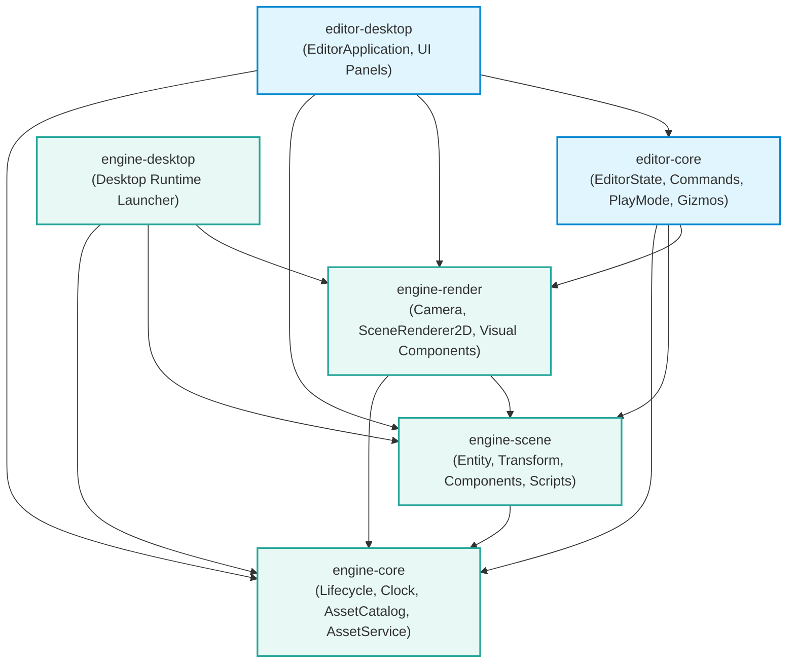
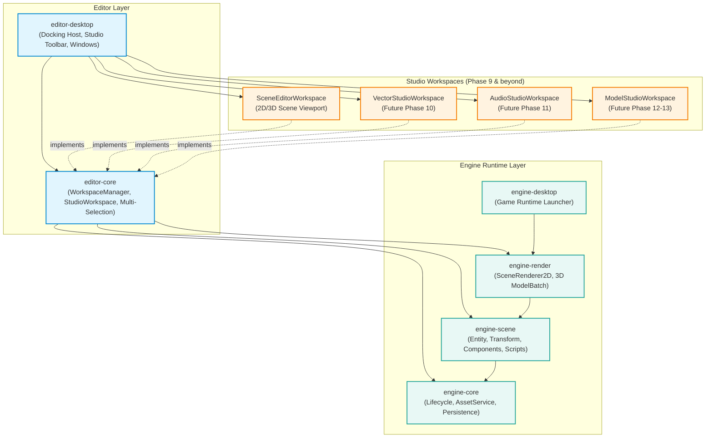

# GdxUnity Phase 9 Architecture Audit and Implementation Plan: Unified Studio Workspace Architecture

**Project:** GdxUnity  
**Document:** `docs/PHASE_9_ARCHITECTURE_AUDIT.md`  
**Target Milestone:** Phase 9 — Unified Docking Workspace & Multi-Studio Architecture  
**Vision Document:** `docs/ALL_IN_ONE_STUDIO_ROADMAP.md`  
**Audit Date:** October 2024 (Verified against active repository baseline)  
**Technology Stack:** Java 21 LTS | LibGDX 1.14.2 | LWJGL3 3.4.1 | Gradle Wrapper 9.6.1 | JUnit Jupiter 5.10.0  
**Status:** Architecture Audit Complete — Awaiting Approval Gate  

---

## 1. Executive Summary

GdxUnity is transitioning from a standalone 2D Unity-like engine/editor into an integrated creative development platform spanning:
- **Game Engine & Scene Editor** (Unity / Godot style).
- **Vector Art Studio** (Inkscape / Illustrator style — Bézier paths, SVG, 9-slice sprites).
- **Audio & Music Studio** (FL Studio / LMMS style — software synthesis, 16-step sequencing, piano roll, mixer rack).
- **3D Model Studio** (Blender style — B-Rep/half-edge mesh modeling, UV unwrapping, materials, skeletal rigging).
- **Game Play Preview** (Isolated runtime simulation).

The long-term vision is chartered in [`docs/ALL_IN_ONE_STUDIO_ROADMAP.md`](file:///c:/Users/lorean.devries/Documents/playground/gdx-unity/docs/ALL_IN_ONE_STUDIO_ROADMAP.md).

This document delivers the **Phase 9 Architecture Audit and Implementation Plan**, executed strictly in **read-only mode** with zero modifications to production code or build definitions.

### Key Audit Conclusions
1. **Repository Baseline Verification**:
   - The reported baseline of Phase 8 / 98 tests has advanced to **Milestone 9** (Java/Kotlin Scripting Foundation).
   - The active test suite contains **101 tests across 22 test suites**, with **100% passing rate (0 failures, 0 errors)** in headless mode.
   - The multi-module build is completely clean under Gradle 9.6.1 and Java 21.
2. **Current Editor Architecture Assessment**:
   - The desktop editor (`editor-desktop`) currently uses a static, hardcoded layout in `EditorApplication`: a root `Table` containing `EditorToolbar`, a middle row (`HierarchyPanel`, transparent viewport area, `InspectorPanel`), `AssetBrowserPanel`, and `EditorStatusBar`.
   - `EditorState` manages a **single selected entity** (`UUID selectedEntityId`). Multi-selection is not yet supported.
   - Input multiplexing routes directly from `Stage` $\rightarrow$ `ViewportInputProcessor` without centralized command shortcut routing or keyboard focus awareness.
3. **Phase 9 Scope & Implementation Recommendation**:
   - Introduce a lightweight, zero-native-dependency `StudioWorkspace` contract and `WorkspaceManager` inside `editor-core`.
   - Upgrade `EditorState` to support deterministic multi-selection (`LinkedHashSet<UUID>`) while preserving 100% backward compatibility with existing single-selection APIs.
   - Implement global shortcut dispatching respecting scene2d keyboard focus (e.g., when editing text in inspector fields).
   - Implement a lightweight, pure LibGDX `scene2d.ui` tabbed workspace switcher and split-pane layout with versioned JSON persistence.
   - Retain the existing 6 Gradle modules for Phase 9 without premature subproject explosion, establishing the contracts in `editor-core` and UI in `editor-desktop` before creating `editor-studios` in Phase 10.

---

## 2. Verified Current Repository Baseline

An exhaustive inspection of the working tree, build configuration, source sets, and test suites was conducted.

### 2.1 Git Status & Working Tree
- Working directory: `c:\Users\lorean.devries\Documents\playground\gdx-unity`
- Git status: Clean tracking branch with uncommitted configuration updates in `build.gradle`, `gradle.properties`, and `settings.gradle` establishing the 6-module structure and Java 21 toolchain.
- Active milestone docs in `docs/`:
  - `phase-8-current-state.md` (reported 98 tests).
  - `milestones/milestone-9-scripting-foundation.md` (verified 101 tests).
  - `ALL_IN_ONE_STUDIO_ROADMAP.md` (long-term studio roadmap).
  - `ARCHITECTURE_ASSESSMENT_AND_ROADMAP.md` (long-term architecture assessment).

### 2.2 Gradle Multi-Module Topology
Subprojects registered in `settings.gradle`:
```groovy
include 'engine-core', 'engine-scene', 'engine-render', 'engine-desktop', 'editor-core', 'editor-desktop'
```

### 2.3 Verified Automated Test Suite Results
Headless automated test execution via Gradle wrapper (`./gradlew.bat test --rerun`):

| Subproject | Test Count | Failures | Errors | Duration | Status |
| :--- | :---: | :---: | :---: | :---: | :---: |
| **`engine-core`** | 27 | 0 | 0 | 2.62s | **PASSED** |
| **`engine-scene`** | 27 | 0 | 0 | 3.25s | **PASSED** |
| **`engine-render`** | 13 | 0 | 0 | 2.41s | **PASSED** |
| **`editor-core`** | 34 | 0 | 0 | 23.25s | **PASSED** |
| **`engine-desktop`** | 0 (Runnable application) | - | - | - | **NO-SOURCE** |
| **`editor-desktop`** | 0 (Manual UI launcher) | - | - | - | **NO-SOURCE** |
| **Total** | **101** | **0** | **0** | **31.53s** | **100% SUCCESS** |

*Verification Note:* The test suite grew from 98 tests in Phase 8 to **101 tests** in Milestone 9 with the addition of `ScriptComponentTest`, `EntityScriptBindingSerializationTest`, and polyglot `ScriptCompilerTest` (Java `javax.tools` and Kotlin `K2JVMCompiler`).

---

## 3. Actual Module and Dependency Inventory

### 3.1 Subproject Inventory Table

| Subproject | Responsibility | Direct Dependencies | Public Contract Packages |
| :--- | :--- | :--- | :--- |
| **`engine-core`** | Engine lifecycle, `FrameClock`, `ResourceManager`, persistent `AssetReference`, `AssetCatalog`, and `AssetService`. | `gdx`, `gdx-platform` | `io.github.ldev22live.gdxunity.engine.core`<br>`...engine.core.asset` |
| **`engine-scene`** | `Entity`, `Transform`, `Component`, `Scene`, `SceneSerializer`, and `ScriptComponent`. | `engine-core`, `gdx` | `io.github.ldev22live.gdxunity.engine.scene`<br>`...engine.scene.scripting`<br>`...engine.scene.serialization` |
| **`engine-render`** | `OrthographicCamera2D`, `SceneRenderer2D`, `ShapeRendererComponent`, `SpriteRendererComponent`. | `engine-core`, `engine-scene`, `gdx` | `io.github.ldev22live.gdxunity.engine.render`<br>`...engine.render.camera`<br>`...engine.render.components` |
| **`engine-desktop`** | Desktop standalone runtime game launcher. | `engine-core`, `engine-scene`, `engine-render`, `gdx-backend-lwjgl3` | `io.github.ldev22live.gdxunity.engine.desktop` |
| **`editor-core`** | `EditorState`, `CommandHistory`, `EditorCommand`, `GizmoInteractionController`, `ViewportPicker`, `PlayModeController`, `ScriptManager`. | `engine-core`, `engine-scene`, `engine-render`, `kotlin-compiler-embeddable` | `io.github.ldev22live.gdxunity.editor.core`<br>`...editor.core.command`<br>`...editor.core.gizmo`<br>`...editor.core.play`<br>`...editor.core.scripting` |
| **`editor-desktop`** | LibGDX `ApplicationAdapter` shell (`EditorApplication`), `scene2d.ui` panels (`HierarchyPanel`, `InspectorPanel`, `AssetBrowserPanel`, `EditorToolbar`, `EditorStatusBar`). | `editor-core`, `engine-core`, `engine-scene`, `engine-render`, `gdx-backend-lwjgl3` | `io.github.ldev22live.gdxunity.editor.desktop`<br>`...editor.desktop.ui` |

### 3.2 Architectural Boundary Invariants
The current codebase adheres to strict boundary invariants:
1. **Zero Editor Leakage into Engine**: Neither `engine-core`, `engine-scene`, nor `engine-render` import any class from `editor-core` or `editor-desktop`.
2. **Headless Execution Independence**: `editor-core` has zero dependencies on `editor-desktop` or LWJGL3, enabling pure JUnit 5 testability without an OpenGL window.
3. **Single Ownership of Rendering Pipeline**: `SceneRenderer2D` renders world entities; `scene2d.ui` `Stage` renders user interface widgets on an overlay projection.

---

## 4. Current Editor Architecture Assessment

Detailed audit of [`EditorApplication.java`](file:///c:/Users/lorean.devries/Documents/playground/gdx-unity/editor-desktop/src/main/java/io/github/ldev22live/gdxunity/editor/desktop/EditorApplication.java), [`EditorState.java`](file:///c:/Users/lorean.devries/Documents/playground/gdx-unity/editor-core/src/main/java/io/github/ldev22live/gdxunity/editor/core/EditorState.java), and related UI panels:

### 4.1 Layout and Panel Composition
- **Current Mechanism**: `EditorApplication.buildUi()` constructs a single static LibGDX `Table` added to `uiStage`:
  ```
  ┌────────────────────────────────────────────────────────────────────────┐
  │ EditorToolbar (height: 36px)                                           │
  ├───────────────────┬───────────────────────────────┬────────────────────┤
  │ HierarchyPanel    │ Viewport Spacer               │ InspectorPanel     │
  │ (width: 220px)    │ (Transparent Table area       │ (width: 260px)     │
  │                   │  overlaid on OpenGL scene)    │                    │
  ├───────────────────┴───────────────────────────────┴────────────────────┤
  │ AssetBrowserPanel (height: 120px)                                      │
  ├────────────────────────────────────────────────────────────────────────┤
  │ EditorStatusBar (height: 24px)                                         │
  └────────────────────────────────────────────────────────────────────────┘
  ```
- **Limitation**: Panel dimensions are hardcoded (`220px`, `260px`, `120px`). There are no splitters, no collapse/expand toggles, no tabbed containers, and no mechanism to swap out the center viewport for specialized studio tooling (e.g. vector art canvas, audio sequencer, or 3D mesh modeler).

### 4.2 State and Entity Selection
- **Current Mechanism**: `EditorState` stores `private UUID selectedEntityId`.
- **Limitation**:
  - `setSelectedEntity(Entity)` and `setSelectedEntityId(UUID)` enforce single-entity selection.
  - Box/marquee selection in the viewport and Shift/Ctrl click multi-selection in `HierarchyPanel` cannot be represented.
  - Batch operations (e.g. deleting 5 entities, translating a cluster of objects, or assigning materials) are blocked by the data model.

### 4.3 Input Routing and Focus Handling
- **Current Mechanism**: Input is managed by a LibGDX `InputMultiplexer`:
  1. `uiStage`: Processes `scene2d.ui` actors (buttons, text fields, scroll panes).
  2. `ViewportInputProcessor`: Handles mouse clicks, drags, mouse wheel zoom, and keyboard shortcuts (`Ctrl+Z`, `Ctrl+Y`).
- **Limitation & Flaw**:
  - Shortcuts like `Ctrl+Z` are handled in `ViewportInputProcessor.keyDown()`. However, if a user is focused inside a `TextField` in `InspectorPanel`, `uiStage.keyDown()` returns `false` if unhandled by the field, allowing the event to bleed through to `ViewportInputProcessor`.
  - There is no formal keyboard focus registry. When users press `Space` to play/pause or `Delete` to remove an entity, it could delete the entity while the user is actively typing a name in a text box.

### 4.4 Command History and Undo/Redo
- **Current Mechanism**: `CommandHistory` maintains `undoStack` and `redoStack` with configurable maximum depth (default: 100).
- **Quality State**: Excellent. Commands implement `execute()`, `undo()`, and `getDescription()`. Full transaction isolation is maintained during Play Mode (mutations blocked while playing).

### 4.5 Asset Pipeline and Ownership
- **Current Mechanism**: `AssetCatalog` discovers files in `assets/`; `AssetService` manages centralized texture caching; `EditorState.selectedAsset` tracks the active asset.
- **Quality State**: Clean project-relative paths (`AssetReference`) and safe LIFO disposal. Ready to support additional asset types (`.svg`, `.wav`, `.synth`, `.mesh`).

---

## 5. Existing Functionality That Must Be Preserved

During the Phase 9 evolution, the following verified capabilities must remain strictly unbroken:
1. **2D Runtime & Rendering**: Orthographic camera projection, viewport resize behavior, shape and sprite batch rendering.
2. **Entity & Component Model**: Stable UUID entity identity, hierarchical transform parent-child propagation with dirty flag optimization.
3. **Serialization Integrity**: Versioned JSON serialization (`SceneSerializer`, schema version 1) saving/loading complete scenes with components and script bindings.
4. **Play-Mode Isolation**: Scene cloning via JSON serialization before simulation, disallowing authoring mutations while active, and clean state restoration on Stop.
5. **Interactive Gizmos**: Move, Rotate, Scale visual gizmo hit-testing, dragging, and undoable transform updates.
6. **Existing Command Architecture**: All 8 concrete `EditorCommand` implementations (`CreateEntityCommand`, `DeleteEntityCommand`, `ChangeTransformCommand`, `AssignSpriteAssetCommand`, `AddComponentCommand`, etc.).
7. **Polyglot Scripting**: Dynamic Java/Kotlin compilation and lifecycle execution during Play Mode.

---

## 6. Current and Proposed Dependency Diagrams

### 6.1 Current Phase 8/9 Module Diagram



### 6.2 Proposed Phase 9 Target Architecture Diagram



---

## 7. Proposed Studio Workspace Contracts

To decouple specialized creative studios (Vector, Audio, 3D) from the editor shell without creating circular dependencies, we define two foundational contracts in `editor-core`:

### 7.1 `StudioWorkspace` Contract (`editor-core`)
```java
package io.github.ldev22live.gdxunity.editor.core.workspace;

import com.badlogic.gdx.scenes.scene2d.Actor;

/**
 * Contract representing an independent creative environment inside GdxUnity.
 * Decoupled from concrete desktop windowing or OS shell implementations.
 */
public interface StudioWorkspace {
    /**
     * Unique, stable identifier for this workspace (e.g., "scene-editor", "vector-studio", "audio-studio", "model-studio").
     */
    String getId();

    /**
     * Display title shown in the workspace navigation bar and tab headers.
     */
    String getDisplayName();

    /**
     * Called once when the workspace is registered into the WorkspaceManager.
     */
    void initialize(WorkspaceContext context);

    /**
     * Returns the root scene2d Actor / Table representing the UI and canvas for this studio.
     */
    Actor getRootActor();

    /**
     * Invoked when this studio becomes the active, visible workspace.
     */
    void onActivated();

    /**
     * Invoked when navigating away from this studio to another workspace.
     */
    void onDeactivated();

    /**
     * Per-frame logic update.
     */
    void update(float deltaTime);

    /**
     * Per-frame rendering pass for hardware viewports (OpenGL/ModelBatch/SceneRenderer)
     * executed before scene2d UI overlay rendering.
     */
    void render(float deltaTime);

    /**
     * Handle window resize events for internal viewports and cameras.
     */
    void resize(int width, int height);

    /**
     * Cleanly release all GPU and memory resources owned by this workspace.
     */
    void dispose();
}
```

### 7.2 `WorkspaceManager` Contract (`editor-core`)
```java
package io.github.ldev22live.gdxunity.editor.core.workspace;

import java.util.Collection;
import java.util.Optional;

/**
 * Coordinates studio registration, switching, lifecycle transitions, and layout persistence.
 */
public interface WorkspaceManager {
    void registerWorkspace(StudioWorkspace workspace);
    void unregisterWorkspace(String workspaceId);
    
    Collection<StudioWorkspace> getRegisteredWorkspaces();
    Optional<StudioWorkspace> getWorkspace(String workspaceId);
    
    StudioWorkspace getActiveWorkspace();
    boolean setActiveWorkspace(String workspaceId);

    void addListener(WorkspaceListener listener);
    void removeListener(WorkspaceListener listener);

    interface WorkspaceListener {
        void onWorkspaceChanging(StudioWorkspace current, StudioWorkspace upcoming);
        void onWorkspaceChanged(StudioWorkspace previous, StudioWorkspace active);
    }
}
```

---

## 8. Multi-Selection and Global Input-Routing Design

### 8.1 Multi-Entity Selection Model in `EditorState`
To support batch transformations, multi-entity deletion, and group grouping across both Scene and future 3D/Vector studios, `EditorState` must evolve from `UUID selectedEntityId` to an ordered set:

```java
// Authoritative internal storage: maintains insertion order and unique entity IDs
private final Set<UUID> selectedEntityIds = new LinkedHashSet<>();
private UUID primarySelectedEntityId = null;
```

#### Backward Compatibility Guarantees:
- `getSelectedEntityId()`: Returns `primarySelectedEntityId` (or the first element in `selectedEntityIds` if null).
- `getSelectedEntity()`: Returns the entity corresponding to `primarySelectedEntityId`.
- `setSelectedEntity(Entity)`: Clears existing selection, adds `entity.getId()`, and sets it as primary.
- `setSelectedEntityId(UUID)`: Clears existing selection, adds `UUID`, and sets it as primary.

#### New Multi-Selection APIs:
- `Set<UUID> getSelectedEntityIds()`: Returns an unmodifiable view of all currently selected entity IDs.
- `boolean isSelected(UUID entityId)`: Fast $O(1)$ containment check.
- `void addSelectedEntityId(UUID entityId)`: Appends an entity to the active selection (for Shift/Ctrl click).
- `void removeSelectedEntityId(UUID entityId)`: Removes a single entity from the selection.
- `void setSelectedEntityIds(Collection<UUID> entityIds, UUID primary)`: Sets a new batch selection atomically.

#### Observable Selection Event:
```java
public interface Listener {
    default void onSelectionChanged(Set<UUID> previousSelection, Set<UUID> newSelection, UUID primarySelectedId) {}
}
```

### 8.2 Global Command & Input Routing Architecture
Currently, keyboard shortcuts (`Ctrl+Z`, `Ctrl+Y`) are evaluated inside `ViewportInputProcessor`, bypassing focused text fields.

We introduce a centralized `EditorKeyboardDispatcher` in `editor-core`:
1. **Focus Check**: Before handling any hotkey, inspect `Stage.getKeyboardFocus()`. If an active text field or editable widget owns focus:
   - Allow text input (`Ctrl+A`, `Ctrl+C`, `Ctrl+V`, Backspace, typing).
   - Suppress global tool shortcuts (`W`, `E`, `R`, `Delete`, `Space`).
2. **Context-Sensitive Hierarchy**:
   - Level 1: Global system shortcuts (`Ctrl+S` = Save, `Ctrl+Z` = Undo, `Ctrl+Y` = Redo).
   - Level 2: Active Workspace shortcuts (e.g. `P` for Pen Tool in Vector Studio; `E` for Extrude in 3D Studio; `Space` for Play/Pause in Scene View).
   - Level 3: Viewport navigation (Middle-drag pan, wheel zoom).

---

## 9. Docking and Layout-Persistence Design

### 9.1 Lightweight `scene2d.ui` Docking Strategy
Rather than importing a heavyweight native docking library (such as Dear ImGui or JSplitPane/Swing bridges) which would violate cross-platform goals and break LibGDX mobile/web portability:

1. **Pure `scene2d.ui` SplitPanes & Tabs**:
   - Build a lightweight `DockableContainer` using LibGDX's built-in `SplitPane`, `Stack`, and `Table`.
   - Provide horizontal and vertical draggable splitters with minimum panel dimensions (`minWidth = 150px`, `minHeight = 80px`).
   - Support tabbed panel groups where multiple panels (`Hierarchy`, `Assets`, `Console`) share a dock region.
2. **Studio Switcher Toolbar**:
   - A modern top navigation strip featuring distinct studio buttons:
     - 🎮 `Scene Editor`
     - 🎨 `Vector Art Studio`
     - 🎵 `Audio & Music Studio`
     - 🧊 `3D Model Studio`
     - 🕹️ `Play Preview`
   - Clicking a studio switches the center dock area instantaneously without tearing down background scenes or losing undo history.

### 9.2 Layout Persistence Model (`layout.json`)
Workspace panel arrangements and split-ratios are stored in a versioned JSON schema:
```json
{
  "version": 1,
  "activeWorkspaceId": "scene-editor",
  "layouts": {
    "scene-editor": {
      "splitRatioMain": 0.8,
      "splitRatioLeft": 0.25,
      "splitRatioRight": 0.25,
      "bottomPanelCollapsed": false
    }
  }
}
```
**Recovery & Fallback Policy**: If `layout.json` is missing, corrupted, or specifies ratios outside $[0.1, 0.9]$, the layout manager resets gracefully to factory defaults with zero crash risk.

---

## 10. Shared Creative-Platform Prerequisites

Before Phase 10 (Vector Studio), Phase 11 (Audio Studio), and Phase 12 (3D Studio) can begin, the following shared platform services must be verified:

| Shared Service | Current Baseline Status | Phase 9 Requirement | Dependent Future Phases |
| :--- | :--- | :--- | :--- |
| **Project & Asset Identity** | Fully implemented (`AssetReference`, `AssetType`, `AssetMetadata`). | Add enum values: `VECTOR_SVG`, `AUDIO_SYNTH`, `AUDIO_SAMPLE`, `MODEL_3D`. | Phases 10, 11, 12 |
| **Asset Catalog & Discovery** | Implemented in `engine-core` (`AssetCatalog`). | Ensure file watcher and discovery filters support `.svg`, `.wav`, `.ogg`, `.obj`. | Phases 10, 11, 12 |
| **Versioned Serialization** | Implemented (`SceneSerializer`, schema version 1). | Maintain strict schema versioning for vector paths and synth presets. | Phases 10, 11, 13 |
| **Resource Disposal Safety** | Implemented (`ResourceManager`, LIFO disposal). | Guarantee studio transitions dispose transient textures without killing shared caches. | Phases 10–15 |
| **Reversible Commands** | Implemented (`CommandHistory`, `EditorCommand`). | Support batch commands (`CompoundCommand`) for multi-entity actions. | Phases 9–15 |
| **Workspace Persistence** | Not yet implemented (hardcoded UI table). | Implement `WorkspaceLayoutSerializer` in `editor-core`. | Phase 9 |
| **Platform Capability Detection**| LibGDX standard desktop. | Add headless capability checks (`hasAudio`, `hasHardwareGpu`). | Phase 11 (Audio) |

---

## 11. Phase 9 Task Breakdown and Acceptance Criteria

Phase 9 is broken into 5 sequential, verifiable tasks:

### Task 9.1: Multi-Entity Selection Model
- **Objective**: Upgrade `EditorState` to support `LinkedHashSet<UUID>` multi-selection while maintaining 100% backward compatibility for all existing callers.
- **Files Modified**: `editor-core/.../EditorState.java`.
- **Files Added**: Unit tests in `editor-core/.../EditorStateMultiSelectionTest.java`.
- **Acceptance Criteria**:
  1. `getSelectedEntityId()` returns the primary selected ID.
  2. `getSelectedEntityIds()` returns an unmodifiable set of all selected IDs.
  3. Single-entity methods continue to function identically with zero regressions.
  4. 100% existing test pass rate maintained.

### Task 9.2: `StudioWorkspace` & `WorkspaceManager` Abstractions
- **Objective**: Establish the core workspace contracts and registration manager in `editor-core`.
- **Files Added**:
  - `editor-core/.../workspace/StudioWorkspace.java`
  - `editor-core/.../workspace/WorkspaceContext.java`
  - `editor-core/.../workspace/WorkspaceManager.java`
  - `editor-core/.../workspace/DefaultWorkspaceManager.java`
  - `editor-core/.../workspace/WorkspaceListener.java`
- **Acceptance Criteria**:
  1. Multiple workspaces can be registered and queried by unique ID.
  2. Switching active workspace invokes `onDeactivated()` on previous and `onActivated()` on next.
  3. Headless unit tests verify error handling when activating unregistered workspace IDs.

### Task 9.3: Centralized Keyboard Shortcut & Focus Dispatcher
- **Objective**: Prevent hotkey leakage when typing in text fields and centralize command shortcut execution.
- **Files Added**: `editor-core/.../input/EditorKeyboardDispatcher.java`.
- **Acceptance Criteria**:
  1. Typing in text fields does not trigger editor tool switching or scene deletion.
  2. `Ctrl+Z` / `Ctrl+Y` routes to `CommandHistory` undo/redo globally.
  3. Headless tests verify key event routing under simulated focus conditions.

### Task 9.4: Dockable Split-Pane & Tabbed Workspace Shell
- **Objective**: Upgrade `editor-desktop` layout from static tables to dynamic, resizable split-panes.
- **Files Modified**:
  - `editor-desktop/.../EditorApplication.java`
  - `editor-desktop/.../ui/EditorToolbar.java`
- **Files Added**:
  - `editor-desktop/.../ui/workspace/StudioNavigationBar.java`
  - `editor-desktop/.../ui/workspace/DockableWorkspacePanel.java`
  - `editor-desktop/.../workspaces/SceneEditorWorkspace.java`
- **Acceptance Criteria**:
  1. Center workspace hosts `SceneEditorWorkspace` preserving existing 2D camera and gizmo workflows.
  2. Top navigation strip allows switching between registered studios (with placeholders for Vector, Audio, 3D).
  3. Dragging panel splitters resizes panels smoothly without crashing or visual glitching.

### Task 9.5: Workspace Layout Persistence & Default Recovery
- **Objective**: Save and load user panel sizes and split ratios to `layout.json`.
- **Files Added**: `editor-core/.../workspace/WorkspaceLayoutSerializer.java`.
- **Acceptance Criteria**:
  1. Closing and reopening the editor restores panel proportions.
  2. Corrupted or invalid JSON automatically falls back to factory default proportions.

---

## 12. Test and Regression Strategy

1. **Automated Headless Unit Tests (JUnit 5)**:
   - Add new tests in `editor-core` validating multi-selection, workspace manager transitions, layout serialization, and shortcut dispatching.
   - Run `./gradlew.bat test` ensuring total test count increases from 101 to $>115$ with 0 failures.
2. **Play Mode Isolation Check**:
   - Verify that switching workspaces while in Play Mode either pauses simulation or cleanly preserves runtime scene isolation without corrupting authored data.
3. **Undo/Redo Verification**:
   - Ensure `CommandHistory` operates across multi-selection without losing hierarchy integrity.
4. **Manual Desktop Verification**:
   - Launch `./gradlew.bat :editor-desktop:run` and verify:
     - Viewport pan/zoom and gizmos operate identically.
     - Splitters can be resized.
     - Studio navigation bar switches views smoothly.

---

## 13. Cross-Platform Risks and Limitations

| Platform | Capabilities in Phase 9 | Limitations & Risks |
| :--- | :--- | :--- |
| **Desktop (LWJGL3)** | Full functionality: multi-window, hardware mouse/keyboard, file I/O, OpenGL 3.0+. | None. Primary authoring target. |
| **Mobile (Android/iOS)**| Workspace shell can render via LibGDX `scene2d.ui`. | Limited screen real estate makes full multi-docking unfeasible; requires single-studio full-screen tab mode. Desktop authoring remains primary. |
| **Browser (Web/TeaVM)**| Supported by `scene2d.ui` canvas rendering. | File system I/O must be virtualized (IndexedDB/local storage). Dynamic Java/Kotlin compilation is desktop-only. |

---

## 14. Risks, Alternatives, and Unresolved Decisions

### Risk 1: Introducing New Gradle Modules Too Early
- **Assessment**: Creating `editor-studios`, `engine-vector`, and `engine-audio` in Phase 9 before having concrete implementations would add build overhead and empty skeletons.
- **Mitigation**: Define contracts in `editor-core` in Phase 9. Create `editor-studios` and `engine-vector` in Phase 10 when vector art authoring begins.

### Risk 2: Heavyweight Docking Frameworks
- **Assessment**: Importing third-party native docking frameworks breaks cross-platform portability and complicates the build.
- **Decision**: Use pure LibGDX `scene2d.ui` (`SplitPane`, `Stack`, `Table`) for lightweight, robust docking.

---

## 15. Explicit Implementation Recommendation & Approval Gate

### Explicit Recommendation
1. **Proceed with Phase 9 implementation** using the 5-task breakdown above.
2. **Keep the 6 Gradle subprojects** for Phase 9 (`engine-core`, `engine-scene`, `engine-render`, `engine-desktop`, `editor-core`, `editor-desktop`).
3. **Upgrade `EditorState`** to support multi-selection with 100% backward compatibility.
4. **Implement `StudioWorkspace` & `WorkspaceManager`** inside `editor-core`.
5. **Implement `SceneEditorWorkspace`** inside `editor-desktop` wrapping the current 2D scene editor.

### Approval Decisions Checklist
- [ ] **Approval Decision 1**: Confirm keeping 6 Gradle modules for Phase 9, deferring `editor-studios` and `engine-vector` to Phase 10.
- [ ] **Approval Decision 2**: Confirm upgrading `EditorState` to support multi-entity selection (`Set<UUID>`) with backward-compatible legacy getters.
- [ ] **Approval Decision 3**: Confirm lightweight pure `scene2d.ui` docking without external native UI libraries.
- [ ] **Approval Decision 4**: Authorize beginning **Task 9.1 (Multi-Entity Selection Model)**.

---
*End of Phase 9 Architecture Audit Report. Ready for review and approval.*
