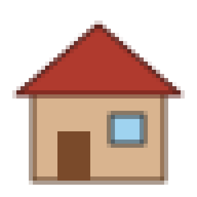
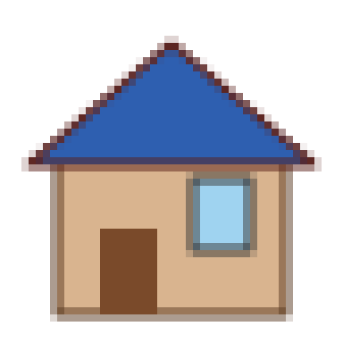

# MC.3 2D Studio slice: progress report (slices 1 to 3)

**Date:** 2026-11-24. **Milestone:** MC.3 (Appendix C4), milestone chart §8. **Status:** **in progress**, not done. **Decision:** TD-104, approved by the owner on 2026-11-24 ("Approve as written"; vector editing in `editor-sprite`).

**Done-when (not yet met):** "the user changes the roof colour and window shape of a 2D house, edits an animated character frame, returns to the world, plays, stops, saves and reopens with the changes intact."

## Plan (TD-104) and where it stands

| Slice | Content | State |
|---|---|---|
| 1 | `engine-vector`: path model, `.vector` file, SVG subset import and export with every unsupported feature reported, headless rasterizer. `VectorSession` in `editor-sprite`: undoable vector edits and rasterize into a sprite layer | **Implemented (this report)** |
| 2 | `.sprite` v2: per-frame hitboxes and a per-layer `source` link to the `.vector` it was drawn from; selection scale and free rotation; sprite sheet and PNG exports that record their source; opening an exported PNG offers its source | **Implemented (2026-11-24, below)**; the web player reads v2 |
| 3 | Edit 2D Asset in Customize; the 2D Studio vector panel; the `VECTOR` asset type; the ForgeRoom-original layered house and animated character fixtures; the done-when slice test and a GL smoke; `.sprite` v2 in the Babylon player and the backend matrix | **Implemented (2026-11-24, below); the done-when test passes.** The Babylon part was done in slice 2 |

## Slice 1: what was built

- **Module `engine-vector`** (new, headless, depends on `engine-core`; listed in `settings.gradle` and the AGENTS.md module table):
  - `Rgba`, `Affine` and `VectorPath` (move, line, quadratic, cubic and close; editable points; flattening within 0.05 units).
  - `VectorShape` (fill, fill rule, stroke, width, opacity and transform) and `VectorDocument` (immutable, named shapes in draw order).
  - `PathData`: every SVG `d` command, absolute and relative, with S and T reflection and arcs converted to cubics per SVG 1.1 F.6. Malformed data is refused with its position.
  - `VectorFile`: `.vector` v1, JSON with path data strings so files diff by line.
  - `SvgImport` reads the TD-104 subset and lists everything else by name: elements, attributes, style properties, colours, transforms and units. Nothing is guessed: an unreadable paint is left out. Doctypes and external entities are refused.
  - `SvgExport` writes the same subset.
  - `VectorRasterizer`: 4×4 samples per pixel, non-zero and even-odd fills, strokes within half their width (round joins and caps), straight-alpha `0xRRGGBBAA` (the sprite cel format).
- **`VectorSession`** (`editor-sprite`, which now depends on `engine-vector`) provides recolour, stroke, move one or several points, insert and delete a node, move, reorder, add and remove a shape, SVG import with its report, save and open. Each edit is one undo step. `rasterizeInto` draws chosen shapes into one sprite cel as one sprite-session step, so the layer can be redrawn from the vector after every edit.

## Evidence

| Check | Result |
|---|---|
| `.\gradlew.bat :engine-vector:test --offline -x generateAssetList` | Exit 0. 20 tests, 0 failures: `PathDataTest` 7, `SvgImportTest` 4, `VectorRasterizerTest` 6, `VectorFileTest` 3 |
| `.\gradlew.bat :editor-sprite:test --offline -x generateAssetList` | Exit 0. 55 tests, 0 failures (51 in the M7a.5 run, +4 `VectorSessionTest`) |
| Fidelity | SVG export then import reproduces every point and transform value within 1e-4, and colours within one 8-bit step |
| Rasterizer against hand-worked pixels | A half-covered column has alpha 128. Pixel-aligned edges are exact. The two fill rules differ on nested squares. A 2-unit stroke covers exactly the two rows it straddles. Half red over blue gives (128, 0, 127). A circle of radius 20 covers π·400 within 1 % |
| Unsupported features | One test file with text, a gradient, `defs`, `use`, `image`, a dash array, an `hsl()` colour, a `perspective` transform, a `stroke-linecap` style and an `mm` width. Each is listed by name, and the three readable rects are kept |

My first run had 3 failing assertions, and all three were wrong expectations in my tests, not bugs. SVG's sweep flag 1 is clockwise on screen, so the left-to-right arc passes above, not below. Attributes of a skipped element are not listed separately, because the element is. I corrected the tests.

Starting and ending HEAD: `b8bace5`. No commit, push or destructive Git operation was performed. A whole-suite run is still owed (it was stopped twice today for low memory). No module other than the two above was run for this slice. The only change outside them is a new dependency of `editor-sprite`, so the modules that depend on `editor-sprite` (`editor-desktop`) were not re-run.

## Slice 2: what was built

- **`.sprite` version 2** (`engine-sprite`):
  - `SpriteHitbox` (named rectangle per frame, may reach past the canvas) and `SpriteLayerSource` (the `.vector` path and shapes a layer is drawn from).
  - `SpriteDocument` keeps both parallel to frames and layers. Inserting, copying, removing and moving frames or layers carries them along, and copy, restore and equality include them.
  - `SpriteFile` writes version 2 only when a sprite has either, so every existing sprite stays a version-1 file. It reads both and refuses anything newer.
  - `SpriteSheet.export` puts each frame's hitboxes in the atlas JSON and, given a `SourceRecord`, the source path and SHA-256.
- **2D Studio, headless** (`editor-sprite`):
  - `SpriteSession.transformSelection(scaleX, scaleY, degrees)`: nearest-neighbour scale and rotation by any angle about the selection's centre, one undo step. It adds no blended colours and transparent pixels don't cover what is below. The selection becomes the result's bounds. The old square-only quarter turn stays.
  - `setHitbox` and `removeHitbox` on the current frame, and `setLayerSource`, each one undo step.
  - `VectorSession.rasterizeInto(..., vectorPath)` draws and links the layer in one sprite step.
  - `SpriteExports` builds the source record for an export, writes the sidecar of a lone PNG (`<name>.png.source.json`), and tells a PNG's origin: no source, current, changed since export, or missing. Each comes with one sentence for the person.
- **Sprites panel** (`editor-desktop`): Export records the saved sprite as the sheet's source, or tells you to save first. Import Sheet appends the PNG's origin advice to its status line.
- **Game side** (`engine-render`): `SpriteAnimatorComponent.getHitboxes()` returns the hitboxes of the frame shown now.
- **Web player** (`engine-babylon`): reads `.sprite` versions 1 and 2 and the per-frame hitboxes. A layer's vector source is desktop authoring data and is ignored. `docs/BACKEND_SUPPORT_MATRIX.md` is updated.

### Slice 2 evidence

| Check | Result |
|---|---|
| `.\gradlew.bat :engine-sprite:test :editor-sprite:test --continue --offline -x generateAssetList` | Exit 0. engine-sprite 49 tests (44 before, +5 `SpriteHitboxFileTest`) and editor-sprite 60 (55 after slice 1, +5 `SpriteSourceAndTransformTest`), 0 failures |
| `.\gradlew.bat :engine-render:test --tests "*SpriteAnimatorComponentTest"` | Exit 0. 10 tests (+1: the hitboxes of the frame shown, before and after the frame changes) |
| `.\gradlew.bat :engine-desktop:test --tests "*BackendSupportMatrixTest"` | Exit 0 (the matrix still parses) |
| `.\gradlew.bat :editor-desktop:compileTestJava` | Exit 0 (the panel compiles). The editor-desktop suite was not run |
| `npx vitest run` in `engine-babylon`, and `npx tsc --noEmit` | tsc exit 0. vitest: 519 tests, 518 passed, including the new `shouldReadVersionTwoHitboxesAndIgnoreLayerSources`, and **1 failed**: `sceneBuilder.test.ts > shouldSupportEveryComponentTypeUsedByTheSamples`, because `action-rpg-valley-3d.json` uses `AtmosphereComponent`. That sample was already modified in the working tree before this session; this slice did not touch it. A first run showed 2 failures in the same file, so it may also be timing-sensitive. **Not fixed here; it needs its own look.** |
| What the tests pin | A plain sprite is still version 1. A 2×2 block scaled by 2 is 4×4 with the green column 2 pixels wide. A 2×4 selection turned 90° is 4×2 with no pixel lost. A 30° turn introduces no new colours. Export origins: none, current, changed, missing, sidecar. Drawing and linking a layer are one undo step |

## Slice 3: what was built

- **`AssetType.VECTOR`** (`.vector`): imported into `vectors/`. Opening one says it is edited through the sprite layers drawn from it (it has no editor of its own). `SampleInventory` names where it opens.
- **Edit 2D Asset:** Customize > Edit Selected on a sprite is now "Edit 2D Asset <file>" (`CustomizeGateway.EDIT_2D_ASSET`) and opens 2D Studio on it, as "Edit Sprite" did.
- **`SpriteVectorSources`** (`editor-sprite`, headless):
  - Lists a sprite's linked layers and opens each drawing once from the project, keeping its edits and undo history.
  - `link` draws and links a layer in every frame, and `redraw` / `redrawFrom` redraw after a drawing changed. Each is one sprite undo step.
  - `isPaintedOver` says when a layer differs from its drawing, because a redraw would replace hand-painted pixels.
  - `save` writes changed drawings before the sprite.
  - **Decided while building:** a vector layer is the same picture in every frame. The drawing and the sprite keep separate undo histories, so undoing a drawing edit and redrawing is a new sprite step.
- **Sprites panel** (`editor-desktop`):
  - A **Vector source** section for a linked layer. Choose a shape, then set its fill, stroke and width, type a point's position, or move the shape. Undo drawing, Redo and Redraw are there too. Every change redraws every layer drawn from that drawing.
  - A **Hitboxes** row for the current frame (from the Select tool's rectangle) and cyan hitbox outlines on the canvas.
  - A **Transform** field (scale X %, scale Y %, degrees) under Selection.
  - Save writes changed drawings first.
- **Fixture** `fixtures/2d-sources/house/`, a ForgeRoom original under Apache-2.0:
  - `house.vector` is drawn by hand as path data (Wall, Door, Roof, Window).
  - `house.sprite` is made from it by `TwoDHouseFixtureTest`: layers Wall (Wall, Door), Roof and Window, each linked.
  - `manifest.json` records how each file was made and its SHA-256. The test fails if the files drift from what the code makes.
  - The animated character is the shipped `sprites/hero.sprite` of the Sprite Animation sample (6 frames, idle and walk), so no new character fixture was made.
- **The done-when test** `TwoDHouseSliceTest` (`editor-desktop`):
  1. Creates the Sprite Animation sample as a new project, imports the house drawing and sprite, and drags the house into the World.
  2. Customize > Edit 2D Asset, then 2D Studio.
  3. Changes the roof fill to `#2e5fb0` and raises the window's top edge by 3 units, each redrawing the layers. Then undo and redo, and saves the drawing before the sprite.
  4. Paints a walk frame of the hero and gives it an `attack` hitbox.
  5. Back to World: the reloaded sprites show the edits.
  6. Plays the 2D scene with no genre: the Play copy shows the edits, and the walk reaches the edited frame with its hitbox. Then Stop, with the scene JSON unchanged.
  7. Saves, reopens and checks the edits, the saved drawing and the layer links.
  8. Checks that the shipped hero and the fixture are unchanged.

### Slice 3 evidence

| Check | Result |
|---|---|
| `.\gradlew.bat :editor-sprite:test --continue --offline -x generateAssetList` | Exit 0. **66 tests**, 0 failures (60 after slice 2, +5 `SpriteVectorSourcesTest`, +1 `TwoDHouseFixtureTest`) |
| `.\gradlew.bat :editor-desktop:compileJava :editor-core:compileTestJava` | Exit 0 (the panel, the gateway and their tests compile) |
| `.\gradlew.bat :editor-desktop:test --tests "*TwoDHouseSliceTest"`, first run | **Exit 1, 1 test, 1 failure**: `expected: <1> but was: <3>` at Back to World. The test expected one sprite to reload for `hero.sprite`, but the sample has three heroes using it, so 3 is right. The house edit, the hero edit, Customize and the save had passed before that line. I corrected the expectation |
| The same, second run | Stopped by Claude Code for low memory; rerun when the owner asked to continue |
| The same, third run | **Exit 0. 1 test, 0 failures** |
| `.\gradlew.bat :engine-core:test` | Exit 0. 61 tests, 0 failures (includes the new `VECTOR` assertion) |
| `.\gradlew.bat :editor-core:test --continue` | Exit 0. 615 tests, 0 failures (includes `CustomizeGatewayTest` with "Edit 2D Asset coin.sprite" and `AssetOpeningTest` with the `VECTOR` text) |
| Not run | the rest of `editor-desktop` and the whole suite |
| Pictures from the first run (8× zoom, the flattened sprite) | Before:  After:  The roof is blue and the window taller. I looked at both images |

**GL smoke:** not done. The editor was not started, so the Vector source and Hitboxes sections and the hitbox outlines are **Manually Not Verified (Headless Environment)**.

### Acceptance (done-when)

| Criterion | State |
|---|---|
| Change the roof colour and window shape of a 2D house | **Met** in `TwoDHouseSliceTest` (pictures above) |
| Edit an animated character frame | **Met**: the painted walk frame and its `attack` hitbox |
| Return to the world, play, stop | **Met**: the World and the Play copy show the edits; Stop leaves the scene JSON unchanged |
| Save and reopen with the changes intact | **Met**: scene, sprites, drawing and layer links |
| Play as Platformer + 2D | **Changed:** Play refuses Platformer + 2D, a planned pair (roadmap M3c.7). The test plays the 2D scene without a genre; the done-when asks only that it plays |

**MC.3: Implemented, done-when met in a headless test.** Not Validated: the Sprites panel's new sections were not looked at in the running editor (Manually Not Verified, Headless Environment), and the whole suite is still owed.

## Known limitations (slices 1 and 2)

- No hitbox editing on the canvas yet: the panel UI is slice 3. Hitboxes are reachable from code and the API only.
- `transformSelection` is reachable from code only. The Sprites panel still offers just the quarter turn and flips. Panel controls are slice 3.
- Web scripts cannot read hitboxes yet. The web player parses them, but they are not wired to its script API.

## Known limitations (slice 1)

- Nothing is reachable by a user yet: no panel and no asset type. The status is **Implemented**, not Integrated.
- Strokes always have round joins and caps. There are no dashes, gradients, patterns, text, masks or filters (all reported on import).
- SVG groups are folded into their shapes. A group's opacity multiplies into each shape, which differs from SVG where the grouped shapes overlap.
- The rasterizer tests each sample against every edge crossing a row, and every segment's box for strokes. That is fine for sprite-sized canvases (tested to 64 × 64); large canvases have not been measured.

## Known limitations (slice 3)

- Points are edited by typing coordinates. Nodes cannot be dragged on the canvas yet, and nodes cannot be inserted or deleted from the panel (the session supports both).
- The Vector source section edits shapes, not their transforms, fill rules or opacity.
- A PNG export with a recorded source does not yet offer Edit 2D Asset on that source from Customize. Its source is reported in the Sprites panel's import status.
- Web scripts still cannot read hitboxes.

## Next

1. Look at the Sprites panel in the running editor (Vector source, Hitboxes, Transform).
2. Run the whole suite. It is still owed for M3c.6, MC.2 and MC.3.

Starting and ending HEAD for slice 3: `b8bace5`. No commit, push or destructive Git operation was performed.
