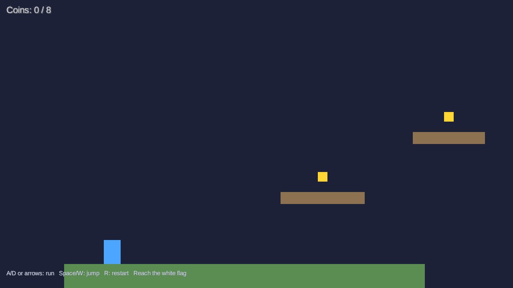
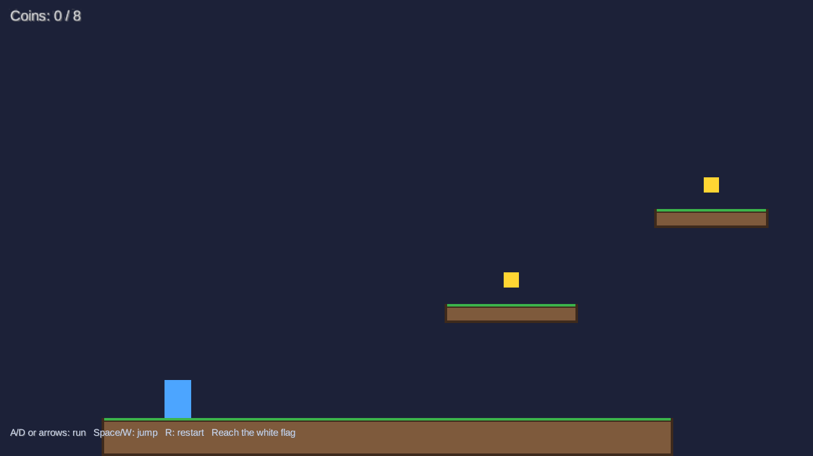
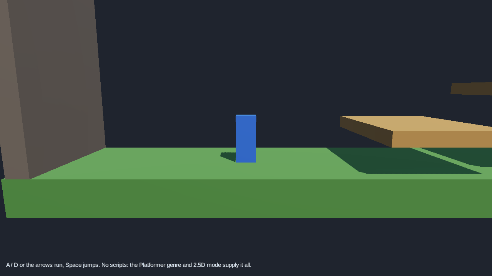
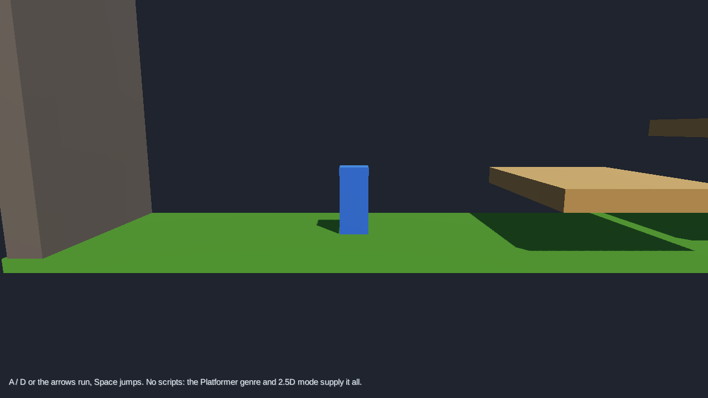

# MP.3: Conservative Migration

**Date:** 2026-11-18. **Branch:** `phase-12-3d-foundation`. **HEAD at start and end:** `0469ceb` (nothing committed). **Gate:** none in the chart.

**Why this milestone:** MP.1 (its only dependency) was done the same day. MP.3 is the next step in the dimension-parity track, and it has no gate.

## 1. What "migrate" means here (decision)

Appendix B4.4 asks for one existing 2D sample and one existing 2.5D sample to be upgraded **opt-in**. The originals and their ids are to be kept, and behaviour and visuals checked before and after. "If the needed source asset or editing subsystem is absent, record a blocker rather than shipping an uneditable facade."

The roadmap's intended target is the curated CC0 starter sets of MP.2. They do not exist: MP.2 needs M2b.2 and M2b.5, and it has a Legal gate. **That part is recorded as blocked** (section 5).

What does exist are the editing systems Appendix B3 lists as each dimension's acceptance:
- 2D: "edit platforms ... tile painting", through the Tiles workspace (TD-066);
- 2.5D: "sculpt 3D terrain ... edit slopes", through World: Terrain (TD-082, M3.3).

So each migration moves a sample's level from hand-typed box sizes to the dimension's editable asset, using only content the project already owns. The choice of samples follows the MP.1 inventory. `platformer-2d` is the main 2D template. `platformer-profile-25d` is the 2.5D sample the inventory named as safest: no Java, and every part PASS.

## 2. Acceptance criteria

| # | Criterion (chart row MP.3 and B4.4) | Status | Evidence |
|---|---|---|---|
| 1 | One existing 2D sample migrated opt-in | **Met** | `samples/platformer-tiles-2d.json`, beside `platformer-2d.json` |
| 2 | One existing 2.5D sample migrated opt-in | **Met** | `samples/platformer-profile-terrain-25d.json`, beside `platformer-profile-25d.json` |
| 3 | Originals preserved | **Met** | Both originals are byte-for-byte unchanged: MD5 checked before and after the generator. `platformer-2d.json` is clean in `git status`; `platformer-profile-25d.json` was already untracked work from M3b.3 and was not modified |
| 4 | Ids and references preserved where possible | **Met** | 2D: every entity except the seven platform boxes keeps its id (asserted). 2.5D: every entity keeps its id, including Ground (asserted) |
| 5 | Behaviour matches | **Met** | 2D: **identical on all 1,200 frames** of a scripted run (position, score, message). 2.5D on real Jolt: largest difference over 600 frames **0.0000076 units** |
| 6 | Visuals match or a blocker is recorded | **Met for layout; the art changes as intended; one difference recorded** | Screenshots below. Same layout, camera and positions. The 2D platforms now show tile art. The 2.5D terrain has no front face (section 4) |
| 7 | Extend only after tests | **Met** | No other sample was touched |

## 3. What was built

- **`tools/make_migrated_samples.py`:** deterministic. It reads the originals and writes the copies, never the originals.
  - **2D:**
    - The seven `Platform *` boxes become one `Level` tile map: 100 × 13 cells of 20 units, auto-tiled with the shared `sprites/tiles.sprite` (the `ground` rule of `tilemap-platformer-2d`).
    - Every original platform edge lies on the 20-unit grid; the tool refuses otherwise. So the tiles cover exactly the original boxes.
    - Coins, goal, player, camera, texts, sounds and music are copied with their ids.
  - **2.5D:**
    - The `Ground` box (3500 × 100 × 400) becomes a flat terrain: `terrains/Platformer Ground.terrain`, 141 × 17 points of 25 units, height 0, with a Terrain Collider 3D.
    - The entity keeps its id and moves to where the box's top was, since a terrain is centred on its entity.
- **`PlatformerPlayer.java` (sample script):** besides `Platform*` boxes, a Tilemap whose Collides is on is now solid: its `getStaticBoxes()`, the same boxes 2D physics uses. The original scene has no tile map, so its behaviour cannot change; `SampleGamesTest`'s platformer test still passes.
- **Gallery:** "2D Platformer (Tiles)" and "Platformer Profile (Terrain)" follow their originals, with previews made by `tools/make_template_previews.py`. `assets/samples/README.md` has a row for each.
- **Tests:**
  - **`SampleGamesTest.shouldPlayTheTiledPlatformerExactlyLikeTheOriginal`:**
    - Both scenes get the same keys for 20 seconds: run right with a jump every 45 frames, pause, run back.
    - The test asserts on every frame that the player's x and y, the score and the message are exactly equal.
    - It also asserts that the run crossed the wall and gap and collected coins.
    - Mutation: with the script's tile-map branch removed, this test fails.
  - **`MigratedPlatformerProfileTest` (engine-desktop, 3):**
    - every original entity, Ground included, keeps its id, and the Ground is now a terrain;
    - the same keys through two real `GameSession`s on Jolt (run, two jumps onto platforms, stop, run back) stay within 5 units on every frame; the measured worst case was 7.6 × 10⁻⁶;
    - the runner stands on the terrain at the box top's height.
- **Pins updated** (new samples are meant to trip them):
  - `EditabilityAuditTest`: the tiles copy keeps the original's Java player.
  - `TemplateRatingsTest`: 45 templates; Partially Editable 21, Checks pending 17.
  - `SampleInventoryTest`: 8 / 8 / 29.
  - The web suite's known-unsupported list: the terrain copy lacks `PlayerComponent` on the web, as its original does.
- **Regenerated:** the M1.1 tables in `FEATURE_TEST_MATRIX.md` and the MP.1 inventory tables.

## 4. Before and after

| Original | Migrated |
|---|---|
|  |  |
|  |  |

These are game-runtime screenshots after 120 frames, with no keys pressed. All four runs reported 0 runtime errors.

- **2D:** the same layout and player position. The platforms are now grass-topped dirt tiles instead of flat green and brown boxes. That is the intended change: the art is now the tile set's, and it is painted in 2D Studio.
- **2.5D:** the camera, runner, walls and platform are the same. **Difference:**
  - a terrain is a surface, so the box's 100-unit front face is gone and the ground reads as a thin sheet;
  - the terrain's default green is darker than the box's.

  Adding a decorative box under it would come back as a mismatched face once the ground is sculpted, so it was not done. Terrain sides or skirts are a terrain feature (R3), not sample work.

## 5. Commands and results

| Command | Exit | Result |
|---|---|---|
| `python tools/make_migrated_samples.py`, then `md5sum -c` on the originals | 0 | Both copies written; originals OK |
| `./gradlew :editor-desktop:test --tests "*SampleGamesTest"` | 0 | 43 of 43 (42 + the comparison) |
| The same with the script's tile-map branch disabled (mutation), then restored | 1, then 0 | 1 failure, the comparison; passes again after restore |
| `./gradlew :engine-desktop:test --tests "*MigratedPlatformerProfileTest"` | 0 | 3 of 3; worst difference 7.6 × 10⁻⁶ units |
| `GDXUNITY_UPDATE_AUDIT=1 ./gradlew :editor-desktop:test --tests "*.audit.*"` | 0 | Tables regenerated after the pins above |
| `./gradlew :editor-desktop:test :engine-desktop:test :editor-core:test --continue` | 0 | Counts below |
| `node scripts/sync-samples.mjs && npx vitest run` (engine-babylon) | 0 | **506 of 506**, after recording the terrain copy's known `PlayerComponent` gap; the first run failed only on that pin |
| `./gradlew :engine-desktop:run --args="--scene samples/<each of the four>.json --smoke-test=120"` with `GDXUNITY_SCREENSHOT` | 0 ×4 | 120 of 120 frames, 0 runtime errors each |
| `./gradlew :engine-desktop:installDist :engine-desktop:gameScriptsClasses`, `python tools/make_template_previews.py platformer-tiles-2d platformer-profile-terrain-25d` | 0 | Two previews written |

| Module | Before | After |
|---|---|---|
| editor-desktop | 169 | **170** (+1 comparison) |
| engine-desktop | 144 | **147** (+3) |
| editor-core | 539 (1 skipped) | 539 (1 skipped) |
| engine-babylon (vitest) | 506 | 506 |

Every sample-wide test now covers the two copies too. That includes `TemplateGalleryProjectsTest` (open, play 2 s and export every template, 45 now), `DuplicateSampleEntitiesTest`, `SceneTextDiffTest` and `CustomizeGatewaySamplesTest`. **Not run:** the full `./gradlew test --continue`.

## 6. Blockers and limitations

- **Blocked: migration to curated CC0 assets.** That needs MP.2's starter sets, and so M2b.2 and M2b.5 and the Legal gate. Both copies use project-owned content only.
- **Web:**
  - the tiles copy needs the web port of `PlatformerPlayer` to read tile maps; it is not marked web, since the web port was not changed;
  - the terrain copy has the original's gap (`PlayerComponent`).
- **The 2D copy still keeps its logic in Java** (M1.2's work), like the original. Only the level became editable.
- **The 2.5D copy's flat terrain** shows no thickness, and its colour is the terrain default (section 4).
- **Manually Not Verified:** painting the tile map in 2D Studio: Tiles, and sculpting the terrain in World: Terrain, by a person in the running editor. Both workspaces exist and are tested in their own milestones, but not on these scenes by hand.

## 7. Diff review and Git

- **New:**
  - `tools/make_migrated_samples.py`
  - `assets/samples/platformer-tiles-2d.json` and `assets/samples/platformer-profile-terrain-25d.json`
  - `assets/terrains/Platformer Ground.terrain`
  - two previews
  - `MigratedPlatformerProfileTest`
  - this report and `docs/reports/mp-3/`
- **Changed:**
  - `assets/scripts/samples/platformer/PlatformerPlayer.java` (tile-map solids), `assets/templates/gallery.json`, `assets/samples/README.md`
  - `SampleGamesTest`, `EditabilityAuditTest`, `TemplateRatingsTest`, `SampleInventoryTest`, `engine-babylon/test/sceneBuilder.test.ts`
  - the generated tables in `FEATURE_TEST_MATRIX.md` and the inventory
  - the chart and the index
- **Already modified before this milestone:** `gallery.json`, `README.md`, `SampleGamesTest`, `TemplateRatingsTest`, `sceneBuilder.test.ts`, the chart, the matrix and the index; only the lines named here were changed. `PlatformerPlayer.java` and `EditabilityAuditTest.java` were clean, and their diffs are this milestone's lines only (9 and 1).
- No commit, push, stash, reset or other Git operation was performed. HEAD is `0469ceb` at start and end.
