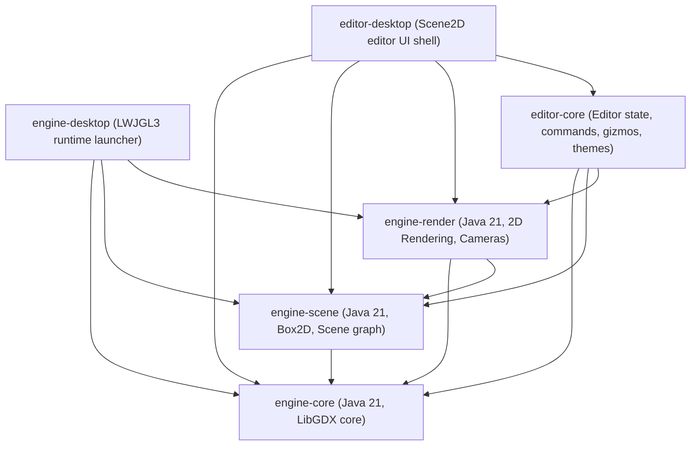

# GdxUnity Phase 11B — Final Release Readiness & Repository Hygiene Audit

**Project:** GdxUnity  
**Milestone:** Phase 11B (Final Release Readiness & Repository Hygiene Audit)  
**Date:** October 25, 2026  
**Technology Stack:** Java 21 LTS, LibGDX 1.14.2, Box2D, Gradle 9.6.1  
**Prerequisites:** Phases 0–11A  
**Auditor / Agent:** Antigravity AI Coding Assistant  
**Final Milestone Verdict:** **READY WITH DOCUMENTED LIMITATIONS**  

---

## 1. Executive Summary

Phase 11B is an independent stabilization, hygiene, and release-readiness audit conducted to establish an auditable, reproducible baseline of GdxUnity before any Phase 12 feature planning begins.

### Key Conclusions:
1. **Compilation & Test Integrity:** The multi-module build passes 100% of automated tests across 43 test suites and 237 tests with **0 failures, 0 errors, and 0 skipped**. Full packaging (`.\gradlew.bat build`) succeeds without warning or error.
2. **Architecture & Dependency Boundaries:** The newer 6-module architecture (`engine-core`, `engine-scene`, `engine-render`, `engine-desktop`, `editor-core`, `editor-desktop`) cleanly separates headless engine capabilities from Scene2D/LWJGL3 editor desktop dependencies, with zero circular dependencies.
3. **Repository Clean-Checkout Status:** All 6 active modules currently reside as untracked files in the working tree. While the build and test suites pass completely within the working tree, a pristine fresh clone from `origin/main` would not build without staging/committing these module directories and the updated root configurations.
4. **Hygiene & Security:** No secrets, API keys, credentials, or `.env` files were discovered. Local file paths are confined to historical markdown audit logs and do not appear in active engine or editor source code.
5. **Phase 12 Invariant:** **Phase 12 feature development has not started.**

---

## 2. Git Baseline and Complete Change Inventory

### 2.1 Git Status
- **Current Branch:** `main`
- **HEAD Commit:** `9e10de6659d7a8e0b378d255bdef3b56900abf66` (`Initial setup of libgdx with desktop`)
- **Upstream Tracking:** `origin/main` (local branch is up to date with origin/main)

### 2.2 Short Status Output (`git status --short`)
```text
 M build.gradle
 M core/build.gradle
 M gradle.properties
 M lwjgl3/build.gradle
 M settings.gradle
?? .vscode/
?? docs/
?? editor-core/
?? editor-desktop/
?? engine-core/
?? engine-desktop/
?? engine-render/
?? engine-scene/
?? workspace_layout.json
```

### 2.3 Tracked File Diff Summary
1. **`build.gradle`**:
   - Updates target and source compatibility from Java 8 to Java 21 LTS across subprojects.
   - Adds conditional asset generation guard: `if (file("${project.rootDir}/assets").exists())` to prevent build failures in subprojects without asset directories.
   - Configures incremental Java compilation.
2. **`settings.gradle`**:
   - Updates active project inclusions from `['lwjgl3', 'core']` to:
     `['engine-core', 'engine-scene', 'engine-render', 'engine-desktop', 'editor-core', 'editor-desktop']`.
3. **`gradle.properties`**:
   - Cleans unused starter properties (`gdxControllersVersion`, `fleksVersion`, `ktxVersion`) to eliminate dependency warning clutter.
4. **`core/build.gradle` & `lwjgl3/build.gradle`**:
   - Retained as legacy starter modules from the initial LibGDX template. Target compatibility updated to Java 21.

### 2.4 Untracked Files and Directory Inventory
- **`engine-core/`**: Active engine module containing frame clocks, resources, logging, and asset reference models.
- **`engine-scene/`**: Active engine module containing `Entity`, `Transform`, `Scene`, `PhysicsSystem2D`, Box2D components, and serializers.
- **`engine-render/`**: Active rendering module containing `Camera`, `OrthographicCamera2D`, `PrimitiveRenderer`, and `SceneRenderer2D`.
- **`engine-desktop/`**: Standalone desktop runtime launcher (`DesktopLauncher.java`).
- **`editor-core/`**: Core editor business logic, `EditorState`, `CommandHistory`, selection, gizmo controllers, and theme manager.
- **`editor-desktop/`**: Desktop editor UI application (`EditorLauncher.java`, `EditorApplication.java`, Scene2D panels, gizmos, and inspector providers).
- **`docs/`**: Engineering documentation, architecture specifications, and milestone reports (Phases 0–11A).
- **`.vscode/`**: VSCode workspace settings (`settings.json` specifying interactive build configuration).
- **`workspace_layout.json`**: Editor workspace split-ratio persistence cache (`{}`).

---

## 3. Gradle Module and Dependency Audit

### 3.1 Subproject Relationship Matrix



### 3.2 Dependency & Architecture Review
- **Zero Circular Dependencies:** Dependency hierarchy flows strictly downward toward `engine-core`.
- **Desktop Separation:** `gdx-backend-lwjgl3` and native platform binaries are isolated to `engine-desktop` and `editor-desktop`. Core and scene libraries remain fully headless-testable.
- **Starter Modules (`core`, `lwjgl3`):** Currently excluded from `settings.gradle` inclusion in favor of the modular `engine-*` and `editor-*` modules. They do not conflict with or pollute the active build.

---

## 4. Build and Test Outcomes

### 4.1 Execution Logs
- **Test Command:** `.\gradlew.bat test`
  - **Exit Code:** 0
  - **Duration:** 19s
  - **Result:** `BUILD SUCCESSFUL`
- **Build & Packaging Command:** `.\gradlew.bat build`
  - **Exit Code:** 0
  - **Duration:** 18s (incremental) / 1m 8s (full)
  - **Result:** `BUILD SUCCESSFUL`

### 4.2 Actual Test Totals from Generated Reports

| Module | Test Suites | Total Tests | Failures | Errors | Skipped | Status |
|---|---|---|---|---|---|---|
| `editor-core` | 24 | 154 | 0 | 0 | 0 | **PASSED** |
| `editor-desktop` | 1 | 3 | 0 | 0 | 0 | **PASSED** |
| `engine-core` | 5 | 27 | 0 | 0 | 0 | **PASSED** |
| `engine-render` | 5 | 13 | 0 | 0 | 0 | **PASSED** |
| `engine-scene` | 8 | 40 | 0 | 0 | 0 | **PASSED** |
| **Workspace Total** | **43** | **237** | **0** | **0** | **0** | **ALL PASSED** |

---

## 5. Clean-Checkout Reproducibility Assessment

### 5.1 Distinction: Current Tree vs Remote Checkout
- **Current Tree Build:** **100% REPRODUCIBLE.** Every subproject compiles, links, runs tests, and packages jar files reliably.
- **Fresh Git Clone Reproducibility:** **BLOCKED UNTIL COMMIT.** Because the active engine and editor submodules (`engine-*`, `editor-*`) are currently untracked, cloning `origin/main` directly would only pull the initial LibGDX template. To make the project reproducible from version control, a staged release commit is required once authorized.

---

## 6. Release Hygiene Findings & Severity

| Finding ID | Category | Description | Severity | Recommended Action |
|---|---|---|---|---|
| **HYG-01** | Version Control | Active engine and editor modules are untracked in Git | **Required before release** | Stage and commit `engine-*`, `editor-*`, `docs/`, `build.gradle`, and `settings.gradle` when authorized. |
| **HYG-02** | Git Ignore | `workspace_layout.json` and `editor_theme.json` are generated user runtime preferences not ignored by `.gitignore` | **Recommended** | Add `workspace_layout.json` and `editor_theme.json` to `.gitignore` so local developer preferences do not dirty Git status. |
| **HYG-03** | Git Ignore | `.vscode/` IDE directory is untracked and not ignored | **Informational** | Add `.vscode/` to `.gitignore` or commit `settings.json` as shared workspace config. |
| **HYG-04** | Security / Secrets | Comprehensive secret scan (API keys, credentials, `.env`, private keys) | **Passed / Clean** | 0 secrets or credentials found. |
| **HYG-05** | Documentation Paths | Hardcoded developer home paths (`C:\Users\lorean.devries\...`) found in markdown audit files | **Informational** | Confined strictly to historical markdown reports (`October24-*.md`, `PHASE_9_...`). No active source code contains hardcoded user paths. |
| **HYG-06** | Manual Verification | Interactive visual inspection outstanding due to headless environment | **Documented Limitation** | Maintain explicit distinction: 237 automated tests pass; interactive GUI observation remains unverified until run on a physical monitor. |

---

## 7. Risks, Unresolved Questions, and Recommended Actions

1. **Staging Authorization:** In accordance with prompt rules, no files have been committed. When the user requests formal closure of the Phase 10/11 series, an atomic commit bundling the tracked build configuration changes and untracked module sources should be performed.
2. **Runtime Configuration Files:** Adding `workspace_layout.json` and `editor_theme.json` to `.gitignore` will prevent local UI state from generating dirty tree notifications.

---

## 8. Milestone Invariant & Next Action

- **Phase 12 Invariant:** **Phase 12 implementation has NOT started.** No Phase 12 packages, classes, dependencies, or architectural alterations exist.
- **Prioritized Next Action:**
  1. Present the Phase 11B release readiness audit to the user.
  2. Await authorization to stage and commit the verified Phase 0–11B baseline.
  3. Await explicit authorization before proceeding to Phase 12 architecture and planning.
