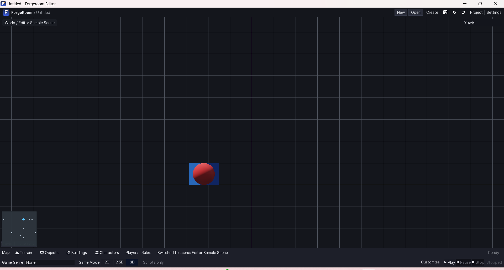
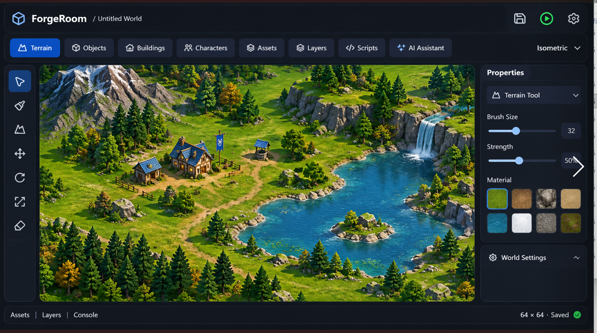

# urGameForge — authoritative milestone roadmap

Revision: 27 November 2026 | Target: unified Desktop + Web Alpha 0.1 | Status: owner-directed roadmap; implementation approvals remain required.

## 1. Authority and product direction

This file (`docs/milestone-roadmap.md`) is the final source of truth for product scope, milestone ordering, dependencies and release acceptance. It supersedes conflicting sequencing and desktop-only release scope in the 15 November master roadmap and prior Alpha plan. Preserve those documents as history, and preserve approved TDs and AGENTS.md governance. milestone-chart.md and FEATURE_TEST_MATRIX.md become evidence/status registers subordinate to this roadmap, not competing plans. Do not silently override technical decisions: raise a TD for approval. Record changes here before changing scope. Existing milestone IDs and evidence remain traceable.

ForgeRoom evolves into **urGameForge**, with a complete Java 21 / LibGDX desktop authoring studio and a streamlined Babylon.js web studio integrated into UrConnex. Both must deliver the same World-first creation journey, not identical feature sets. Desktop remains offline-capable and independently buildable; cloud integration is optional for local editing. Weskaap is an authored project, not an engine dependency. Preserve existing engine code and avoid a big-bang rename of packages or file formats.

### Authoritative visual reference — owner direction, 27 November 2026

- Current desktop evidence: `docs/ui/urGameForge-current-2026-11-27.png` (1920 × 1030 px; SHA-256 `ed893d229e718c5d7ad8cd6090ebf9d8e1647dde96931e8ae001c4dd82639fb8`).
- New target: `docs/ui/urGameForge-target-2026-11-27.png` (1281 × 717 px; SHA-256 `1784a9c497b07eea02e2a5d7896f3bdce9aebb0a037e5589348265c49cbfdf88`). Copy the supplied reference files to these proposed repository paths and verify hashes before work.
- The November 25 reference and November 19 isometric reference are historical, not current acceptance targets. Preserve TD-107/108/109/110/111 and TD-106; propose a superseding UX TD rather than silently changing approved contracts.

Target: branded urGameForge header with project name, Save, Play and Settings; top Terrain / Objects / Buildings / Characters / Assets / Layers / Scripts / AI Assistant workspaces and camera selector; left contextual tool rail; dominant rendered world; right Properties inspector with brush size, strength, material swatches and collapsible World Settings; bottom Assets / Layers / Console drawer tabs and map size/save status. Preserve New/Open, undo/redo, Players, Rules, Genre/Mode, Customize, Stop and existing shortcuts through discoverable menus or contextual panels. Do not remove functionality merely because the concept omits it. AI Assistant is disabled with an accurate explanation until approved integration is ready; web Scripts hands off advanced authoring to desktop.

The landscape is a visual-quality reference, not an asset to use as a background or a promise of pixel-identical output. The valley must be a real editable, navigable, playable scene. Blank grid remains available for empty projects and 2D work; the first-run gallery offers the valley sample. Do not replace existing projects or automatically load a large scene into them.

## 2. Evidence and current baseline

Sources: 15 November Master Roadmap (R0–R10, Appendices E–G); 25 November Current Status; previous Alpha roadmap; owner's latest direction. Reported branch phase-12-3d-foundation, HEAD b8bace5, approximately 170 uncommitted paths; verify before work. R1b and UI M1–8 built but human acceptance missing. R3 terrain and R7a mesh editing built. Seven of 33 genre/mode pairs reported playable; R4 scenario/campaign not started. MC.5/6 and M3c.9 audio blocked. Babylon player 520/521 tests; AtmosphereComponent unsupported, depth ordering gap, no genre profiles; TeaVM broken. WEB authoring phase not started in desktop report; separately deployed web editor capabilities must be audited rather than inferred from player tests. No human validation reported. Full Gradle suite not freshly run. Preserve these distinctions.

## 3. Unified Alpha scope

World dominates the screen with the new top workspace bar, left tool rail, collapsible right inspector and bottom drawers. Retain independent camera orientation, genre/mode, Customize and Play/Stop. Proposed viewport target >=70% of usable editor area with drawers and inspector collapsed; measure expanded layout separately against the reference at 1280x720 and 1920x1080. Desktop retains mesh/sprite and visual scripting authoring; web retains streamlined editing and portable rule execution with explicit desktop handoff. Both must create, edit, play, save/reopen and export or publish supported profiles. Preserve unsupported data on round trip. Desktop standalone export and web playable published preview remain mandatory. No promise of all 33 profiles, full RTS or autonomous prompt-to-game. New V gates below are mandatory for visual acceptance; prior functional evidence remains valid within its tested scope.

## 4. Architecture contract

- Desktop: existing Java/LibGDX/LWJGL, Jolt/Box2D; local project and command system.

- Web: existing Babylon.js, UrConnex Next.js frontend; do not port native LibGDX to browser merely because server has GPU. Audit existing web editor separately from engine-babylon player.

- Shared: versioned engine-neutral project schema, GLB/glTF assets, stable IDs, terrain, scene, prefab, materials, scenario rules, profile metadata, provenance and capability manifests. Adapters for each engine; no assumption of identical physics or shaders.

- UrConnex Spring Boot API owns authenticated project access, tenant authorization, quotas/credits, revision storage and job submission. PostgreSQL metadata and managed asset storage; reuse existing infrastructure after audit. No direct browser or desktop access to database, Ollama or private harness.

- UDX AI (owner terminology; confirm actual service name and contract) is an independent shared AI service, not embedded into either renderer. Reuse UCX AI/TrueForge gateway where verified, with provider-neutral interfaces and future independent LLM. Both editors consume the same typed game-authoring operations through validated plans. Local desktop remains usable without AI or network.

- GPU VPS reported RTX 4000 Ada 20 GB, 32 GB RAM, 8 vCPU. Verify current capacity, workloads and isolation. GPU serves inference, asset generation/processing and optional offline rendering; browser renders locally. No assumption of unlimited concurrency or cloud streaming. Native remote rendering is post-Alpha research requiring offscreen graphics context and WebRTC, not a headless LibGDX shortcut.

## 5. Milestone sequence and dependencies

A00–A10 retain previous desktop acceptance scope; A11–A20 add mandatory shared/web/cloud/AI integration. A11 design starts after A01, before new serialization changes; A12–A15 may proceed alongside desktop work after approved contracts. A16–A19 require verified contracts and isolated environments. A20 requires all mandatory gates including V00–V09. V00–V09 are inserted before final human acceptance; do not renumber A00–A21. A09/A10 and A13/A14/A15 acceptance must be refreshed against the new shell. Existing implementation statuses below are historical evidence, not new visual acceptance. Each gate needs explicit approval, evidence and report; no automatic progression through gated changes.

| Gate | Objective | Dependency | Initial status |

|---|---|---|---|

| A00 | Baseline protection | none | audit done 2026-11-25 ([report](reports/alpha-a00-baseline.md)); checkpoint approval and a fresh full test run outstanding |

| A01 | Screenshot-led desktop/web UX audit | A00 | audit done 2026-11-25 ([report](reports/alpha-a01-ux-audit.md), [proposals](reports/alpha-a02-a11-a13-proposals.md)); reference confirmed; gap list awaiting owner sign-off |

| A02–A03 | World shell, terrain and placement | A01, A11 contract | A02: TD-107 **approved** 2026-11-25; World layout implemented and integrated (default; classic selectable), [report](reports/alpha-a02-world-shell.md); **owner walkthrough pending**. A03: in progress — audit, copy/paste, placement ghost preview, [report](reports/alpha-a03-map-terrain-placement.md); horizontal palette row visible in desktop captures; Map size presets and view lighting integrated; hands-on walkthrough pending |

| A04–A05 | Players, triggers, objectives | A03, A11 | A04: TD-108 approved 2026-11-26; players, bounds, spawn, ownership and placement Owner **implemented and integrated** in the World layout's Players category ([report](reports/alpha-a04-players.md)); human ownership walkthrough and A03 walkthrough pending. A05: TD-109 **approved** 2026-11-26; rules runtime (editor Play and game runtime), Rules drawer and HUD **implemented and integrated** ([report](reports/alpha-a05-rules-objectives.md)); human reach-target/timed-message walkthrough pending |

| A06–A08 | Customize, Play, editable templates | A02–A05 | A06: [audit](reports/alpha-a06-customize.md) 2026-11-26 — covered by M1b.5/M1b.7/M3c.4/M7a/MC.2/MC.3; unsaved mesh edits no longer dropped on leaving 3D Modeling (MeshDraftKeeper); human edit loop pending. A07: [audit](reports/alpha-a07-play-stop.md) 2026-11-26 — seven pairs and Stop restoration covered by tests, repeated 3D Play/Stop with rules added; human keyboard play pending. A08 partial |

| A09–A10 | Desktop package and human acceptance | A08 | pending |

| A11 | Shared architecture/schema TD | A01 | done 2026-11-25: TD-106 approved in principle ([report](reports/alpha-a11-shared-contract.md)) |

| A12 | Cross-engine project adapters | A11 | **met in automated tests 2026-11-25** ([final report](reports/alpha-a12-final-verification-report.md)); TD-106 approved in principle |

| A13 | Babylon World editor UX | A01,A11 | implemented 2026-11-26 in `engine-babylon` ([report](reports/alpha-a13-web-world-shell.md)): World shell default (`?layout=classic` kept), desktop palette prefabs placed as linked instances; not seen in a browser; human gate pending |

| A14 | Web authoring and Play | A12,A13,A04–05 | in progress 2026-11-26 ([report](reports/alpha-a14-web-authoring.md)): scenario rules run in web Play (shared trace with the desktop); web profiles Action RPG 3D + Platformer 2.5D (TD-110) ported and matched to the desktop by a shared movement trace; players, ownership and rule editing in the browser (desktop validates and plays a web-made scenario); terrain, New Ground, Play's fixes and ground check in the browser; the browser-only journey passes in real Chromium (TD-111 Playwright); **implemented and integrated, not validated by a person** |

| A15 | Cross-platform round trip | A12,A14,A06 | In progress. The desktop-first journey exercises a terrain stroke, object ownership, a scenario rule and a unique house model. See the [test and acceptance evidence](reports/alpha-a15-cross-platform-journey.md). |

| A16 | UrConnex project integration | A11,A15 | open |

| A17 | GPU jobs and operational safety | A16 | open |

| A18 | Shared AI command contract and gateway | A11,A16,A17 | open |

| A19 | Bounded AI-assisted game creation | A18,A14,A07 | open |

| A20 | Unified human acceptance and release | A09–A10,A15–A19 | blocked |

| A21 | Asset storage in the UrConnex database, loaded through urconnex-api | A16, urconnex-api ready | added 2026-11-26 by the owner, after A20; storage backend decision (object storage vs database bytes) **paused until urconnex-api is ready** ([report](reports/migration-to-urconnex-report.md)) |

### A00 — Protect the baseline (R0, R9)

- Verify branch `phase-12-3d-foundation`, reported HEAD `b8bace5` and actual working tree. S2 reports about 170 modified/new paths; inventory tracked/untracked changes, generated files, assets, secrets and unrelated work. Preserve all work; no reset, clean, stash or overwrite.

- Prepare a scoped checkpoint commit proposal with file inventory and test evidence; obtain explicit authorization before staging/committing. Do not assume the commit title “Forgeroom alpha” is release evidence.

- Reconcile milestone-chart.md, FEATURE_TEST_MATRIX.md, template audit and BACKEND_SUPPORT_MATRIX.md. Revisit obsolete glTF “no mesh editor” audit rule with capability-specific tests; unsupported skinned/extension cases must still fail honestly.

- Run full Gradle suite with `--continue --max-workers=1` as resources permit; use Windows wrapper and foreground batches on the 16 GB machine. Record per-module counts and skips, never merge stale results as a fresh full run. Run Babylon tests using actual project scripts.

- S2 baseline: editor-core 616 tests/1 skipped/0 failures; engine-desktop 162 before seven additional passing tests; engine-render 213 before latest edits; editor-desktop not fully rerun; Babylon 520/521. Investigate AtmosphereComponent failure; either implement support or obtain approval for explicit unsupported classification and test that degradation is safe. TeaVM remains broken; document as unsupported for desktop Alpha if approved, not a hidden failure.

- Deliver `docs/reports/alpha-a00-baseline.md`. Done: recoverable checkpoint strategy approved, failures classified, no unexplained critical regressions.

### A01 — Reopen the World-first UX acceptance gate (R1b, M1b.5, UI M1–8)

- Launch the actual editor and capture current default World at both target resolutions. Locate owner reference, compare visual hierarchy, viewport size, navigation, drawers, selection, palette, footer and startup flow. If headless, report manual evidence unavailable; do not invent screenshots.

- Inventory every existing command and its destination; identify duplicate toolbars, permanent panels, dead controls, developer-centric labels and excessive steps. Trace actual UI composition and input routing before proposing changes.

- Produce annotated before/after screenshots or clearly labeled wireframes, feature preservation matrix, supported actions, and proposed TD if navigation contract changes. Obtain owner sign-off on layout before coding.

- Done: owner approves target and specific gap list; no claim that prior R1b implementation failed technically merely because UX acceptance remains open.

### A02 — Correct the World shell

- Reuse existing UI framework, World renderer, commands and drawers. Make New/Open/Samples lead directly to World. Retain the existing functional shell as baseline; V01 supersedes its visual layout with the top workspace bar, tool rail, inspector and drawers. Preserve access to Genre/Mode/Customize/Play.

- Add context-aware category switching and collapse/close behavior; advanced tools remain discoverable. Preserve shortcuts, camera controls, selection, undo/redo and save state. Top/isometric/perspective camera choice independent of genre/dimension; use appropriate 2D camera.

- Tests: layout at target sizes/scaling, no overlap, keyboard focus, drawer input isolation, command reachability, no selection loss, no duplicate commands. Human: unfamiliar tester identifies terrain, object placement, Play and Customize without guidance. Record time/steps/friction, not invented usability scores.

- Done: approved actual screenshots and owner walkthrough, not merely headless widget tests.

### A03 — Map, terrain and placement (R2b/R3)

- Map: new map, dimensions/presets, grid/snap, camera navigation and lighting settings; expose only supported settings. Terrain: raise/lower/smooth/flatten, paint, brush size/strength and undo per stroke; contextual water/roads/rivers/erosion only if verified. 2D: tile painting and collision-aware placement.

- Objects/Buildings/Characters: searchable thumbnails, local starter assets, optional provider downloads, ghost preview, valid placement, rotate, move, delete, duplicate, multi-select/copy/paste where supported; stable IDs and collision. Preserve original assets, project-owned derived copies, license manifest and offline cache. Verify realistic tree, rock, house and character or clearly label limitations.

- Tests: terrain save/reopen, undo/redo, collision on modified terrain, repeated placement, invalid placement, missing assets, offline startup, prefab overrides. Human: create valley, paint two surfaces, place tree/rock/house, select and reposition.

- Done: actual World workflow with no JSON edits; report unsupported tools rather than fake them.

### A04 — Players and scenario setup (small R4 slice)

- Audit existing components, graph runtime, player spawn and scene serializers. Propose TD for original scenario data model and ownership semantics; prefer existing modules unless new module approved.

- Minimal player slots (at least two plus neutral if supported), name/color, object ownership, spawn assignment, map bounds and scenario metadata. Contextual player selector in placement palette; ownership visible in selection and persisted. No implication of working diplomacy, economy or unit AI.

- Tests: player ID stability, assignment/reassignment, deletion safeguards, neutral objects, two players, duplicate names/invalid references, undo/redo and round trip. Human: place two groups of objects and change ownership.

- Done: editable scenario setup survives save/reopen; unsupported runtime semantics clearly labeled.

### A05 — Triggers and objectives (small R4 slice)

- Reuse visual scripting and validated commands. Provide approachable Rules drawer: trigger name, enabled state, condition, effect, objective text and status. Advanced graph editor remains in Customize.

- Proposed minimum: timer and player-enter-area conditions; show message, mark objective complete and end scenario effects. Add spawn effect only if safe existing runtime operation supports it. Provide visible validation, deterministic execution order, once/repeat semantics and bounded execution; no arbitrary code execution from scenario data.

- Store rules as original versioned data/graphs after TD approval; references stable, undoable and editable. Show trigger execution log in Play, not default World.

- Tests: timer, area enter, one-shot/repeat, invalid references, objective completion, serialization, runtime isolation, bounded loops. Human: create a reach-target objective and timed message, test both and edit without code.

- Done: at least one genuinely playable scenario with observable rules and objectives. Full RTS selection/orders, pathfinding at scale, economy, fog, campaigns and random map scripts remain post-Alpha. Do not label RTS profile playable unless its own runtime acceptance passes.

### A06 — Customize and return to World (R7a, MC)

- Adjacent Customize/Play always visible. Selection-aware chooser: house → 3D Modeling; sprite → 2D Studio; character → available animation/logic; asset/material tools as supported. Allow entry without selection. Back to World restores project, camera, selection and pending edits; no silent discard/commit.

- Reuse M7a.1–6: vertex/edge/face editing, supported geometry operations, three save modes, project-owned derived model default, explicit shared asset update and unique instance choice. Rebuild render/collision as needed. Verify actual geometry change, not transform-only change.

- Tests: workspace navigation, mesh and sprite edits, undo/redo, shared vs unique semantics, source immutability, save/reopen, next Play uses changes. Human: change house wall/roof, return and replay; edit sprite frame and replay.

- Done: short, predictable owner-approved edit loop. Full material node editor, rigging and UV suite not mandatory for proposed Alpha; basic material properties used by shipped templates must be editable.

### A07 — Play/Stop and scenario runtime (R3b/R3c)

- Freeze profile expansion. Verify seven reported pairs: Platformer 2D/2.5D/3D; Action RPG 2.5D/3D; FPS 3D; TPS 3D. Advertise only combinations that pass actual acceptance; remaining pairs planned. Existing shooters lack health/enemies/ammo/mouse look; do not market complete shooter games.

- Reuse GameTestProfile, PlayModeController, Jolt/Box2D, camera/controller/input. Validate player/spawn, collision, camera and scenario rules before Play; runtime-only components never saved. Stop restores exact authoring scene, selection, camera and undo history. Scenario rule changes must not leak back.

- Test real physics, profile-specific camera/input, terrain collision, trigger execution, invalid prerequisites, repeated Play/Stop, runtime disposal and memory. Human keyboard play of every advertised pair; prioritize three reference projects. Distinguish walkable Action RPG from complete combat.

- Done: verified profiles and scenario objective loop; unsupported profiles refused with actionable explanation.

### A08 — Curated templates and audio gate (R1, Appendix F, MC/R8)

- New Game gallery: Play Sample and Use as Template; independent project copy, original immutable. Prioritize 3D Action RPG valley, 2D Platformer, 2.5D hybrid side-scroller. Use original/licensed assets and editable source. Existing samples preserved; incomplete examples labeled INCOMPLETE/DEMO, not fully editable templates.

- Audit every domain actually used: terrain, mesh, sprite, material, graph, animation, physics, UI, audio, export. Essential gameplay hidden solely in Java/Kotlin is a gap. Correct template audit using real mesh capability. Verify CC0 2D character gate (M2b.5) or use verified original editable sprite with owner-approved exception.

- Audio decision: S2 says M8.1 human listening, M8.5 TD/dependency/Legal, M8.6–7 precede MC.5–6 and M3c.9. Either close these gates and validate audio scenario D, or obtain explicit Alpha exception and label audio limitations; do not advertise complete audio authoring or silently waive Appendix F. Existing Music Studio remains accessible.

- Done: three reference projects meet all applicable Alpha editability criteria or are explicitly classified incomplete; owner approves any reduced scope. Full template library and audio production remain master roadmap obligations.

### A09 — Persistence, packaging and regression (R0/R9)

- Verify project portability, save/close/reopen, stable asset references, migrations/backward compatibility, missing asset errors, scenario metadata, undo and Play isolation. No destructive conversion. Validate source ownership and offline starter assets.

- Build Windows desktop package using existing packaging scripts. Launch clean package on real Windows, create/open project, export standalone game and launch it outside editor. Verify actual controls and rules; artifact existence alone is insufficient. Document runtime dependencies, install/uninstall and rollback.

- Full Gradle and relevant Babylon regression, asset audit, performance baseline on owner hardware; record startup, frame time, memory and scene load, compare with A00. Propose performance thresholds from measured baseline before release; do not invent FPS results. Record web limitations (no genre profiles, depth ordering, atmosphere decision, TeaVM broken) and no unsupported web parity claim.

- Done: no unresolved Alpha-critical data loss, crashes, security/license defects or broken core workflow; known noncritical limits owner-approved.

### A10 — Desktop human acceptance (not the unified release gate)

Owner or unfamiliar human tester runs packaged editor; agent screenshots and automated tests are supplementary, not human validation.

| Journey | Required observed result |

|---|---|

| A: 3D Action RPG | New map → sculpt/paint → tree/rock/player/spawn → Play/walk/collide → Stop → house → Customize geometry → Back → Play → save/reopen/export/launch |

| B: 2D Platformer | Tiles/platform → editable sprite → Play/jump/collide → Stop → edit frame → replay → export/launch |

| C: 2.5D hybrid | 3D scenery + sprite → side camera/locked depth/collision → Stop → edit model/sprite → replay → export/launch |

| E: Scenario authoring (new Alpha gate) | Two player slots → assign objects/spawn → area objective + timed message → Play and observe rules → Stop → edit rule → save/reopen → replay |

| D: Audio (conditional) | Edit notes and SFX → bind scene event → listen in Play → save/reopen/export; or documented owner-approved Alpha exception |

Capture dated screenshots, actual tester observations, test project paths, exported artifact hashes, build version, test logs and limitations. Record PASS/FAIL/BLOCKED/N/A per step; distinguish Implemented, Integrated and Validated (AGENTS.md §9). No desktop acceptance if A/B/C/E core journeys fail or remain unobserved. Owner signs desktop acceptance; unified release requires A20. Proposed version `0.1.0-alpha.1`; do not tag automatically.

## 6. Shared platform and ecosystem milestones

### A11 — Architecture and compatibility contract

- Inventory actual desktop serializers, Babylon reader/editor, UrConnex routes, AI gateway and approved TDs. Distinguish implemented from planned. Design versioned manifest and schema, units/axes, transforms/quaternions, terrain encoding, asset references, material/animation support, scenario rules and profile capabilities. Use existing formats where feasible; do not create a competing format without migration plan.

- Define stable IDs, unknown-field preservation, extension namespaces, schema migration, asset hashes, relative paths, limits, compatibility negotiation and loss reporting. Reject path traversal, unsafe archives and unsupported mandatory features. No silent conversion.

- Define local vs cloud ownership, explicit import/export, revision conflict handling, offline edits and reconnect. No automatic overwrite or sync of private projects. Approve TD before implementation.

- Done: reviewed schema, example fixtures, capability matrix and API/AI boundary contracts.

### A12 — Desktop and Babylon adapters

- Implement readers/writers against A11, preserving existing projects and legacy import. Round-trip canonical fixtures for terrain, house, sprite, prefab, player, material, trigger and profile. Preserve unsupported fields opaque and report them; refuse destructive save if preservation impossible.

- Validate transforms, scale, hierarchy, references, asset hashes, unknown fields, malformed files, version migration and deterministic serialization. Compare semantic equality, not byte equality or pixel-identical physics.

- Done: desktop -> web -> desktop and reverse round trips without data loss; actual render/scene evidence.

### A13 — Screenshot-led web World shell

- Locate owner screenshot and capture actual web editor at desktop browser sizes. Reuse Babylon canvas and existing Next.js routes/components; keep UrConnex navigation compact and project context clear. Map the new V01 workspace navigation and inspector to web, preserving Customize/Play discoverability. Responsive drawers, pointer/touch input, focus, resize, keyboard and accessibility. Advanced unsupported tools show desktop handoff, not fake editors.

- Separate browser editor from exported web player. Do not modify unrelated AR Worlds, media tools or UrConnex pages. Test browser layout and actual canvas interactions, not static screenshots alone.

- Done: owner approves desktop and web before/after screenshots; unfamiliar user finds terrain, placement, Customize and Play without guidance.

### A14 — Web scenario authoring and playable preview

- Reuse actual Babylon terrain/asset features; implement missing map, sculpt/paint, place/move/rotate/delete, selection, undo/redo, player ownership/spawn, basic triggers/objectives and persistence. Support project-managed GLB and licensed starter assets. Implement basic material/instance customization; preserve advanced desktop mesh/graph data.

- Define web-supported profile subset; propose 3D walkable Action RPG and 2D or 2.5D platformer for Alpha, subject to owner approval and real browser tests. Existing web player runs no profiles per report; implement and validate rather than advertise parity. Separate camera mode and game mode. Runtime copy, Stop restoration, collisions, input, rule execution and error handling. No untrusted Java/Kotlin execution in browser or server.

- Done: browser-only user creates a small playable scenario without desktop or manual JSON, saves/reopens and launches preview; unsupported combinations clearly labeled.

### A15 — Cross-platform authoring journey

- Create desktop project, open web, edit terrain/place object/change rule, save new revision, reopen desktop, edit house geometry, reopen web and Play. Reverse journey starting web. Preserve source assets, unknown data, profile metadata and references. Verify offline editing and explicit conflict resolution; no last-write-wins data loss.

- Test incompatible versions, missing assets, concurrent revisions, cancelled upload, interrupted save, large asset limits and recovery. Verify semantic project equality and visual/runtime behavior on both engines.

- Done: both journeys pass with actual projects and documented support matrix.

### A16 — UrConnex ecosystem integration

- Coordinate with UrConnex agent through approved API contract; Windsurf may not modify other repos without authorization. Audit existing GameForge routes, account/tenant roles, subscription entitlements, media/asset library and publishing. Keep branding migration incremental; preserve links and legacy projects.

- Implement authenticated create/list/open/save/revision/download/publish flows, tenant-scoped asset access, quotas and ownership. Desktop optional sign-in using approved token flow, secure OS credential storage, no embedded secrets. Web uses existing session. Private by default; explicit publication and access checks. Collaboration beyond revision conflict handling deferred.

- Test cross-tenant denial, expired tokens, revocation, unauthorized publish, path traversal, upload validation, rollback, offline desktop and failed network. Use isolated test environment; test hostname alone is not proof of isolation. No production DB writes or deployment without approval.

- Done: authorized user can open same cloud project in both clients and publish a playable web preview; another tenant cannot access it.

### A17 — VPS GPU job foundation

- Read-only inventory GPU/VRAM, RAM, disk, current inference/services, queues and security. Reuse existing scheduler if verified. Design bounded asynchronous jobs with job IDs, ownership, progress, cancellation, timeout, retry/idempotency, quotas, cleanup and audit. Separate CPU tasks and GPU tasks; initially one heavy GPU job at a time until measured safe concurrency. Reserve capacity for existing AI and web workloads; no invented VRAM budget.

- Validate output files, provenance/licensing, asset size, malware/unsafe archive handling, temporary storage and tenant isolation. No arbitrary shell or model-generated executable code. No unapproved model downloads, driver changes, service restarts, firewall/SSH changes or production deployment.

- Done: isolated synthetic asset-processing job completes, cancels and fails safely; measured resource usage and contention report. Advanced 3D generation, rigging, animation and rendering providers may be staged later unless separately approved.

### A18 — UDX AI shared authoring interface

- Confirm actual UDX/UCX AI service identity, available endpoints, auth and readiness with responsible agent. Use provider-neutral gateway; no direct model keys in clients. Reuse existing TrueForge/agent registry only after verifying contract. Do not create a second independent production harness inside ForgeRoom.

- Define typed commands for inspect project, create scene, sculpt/paint bounded terrain, place prefab, transform, assign player/spawn, set profile, add objective/trigger, validate and preview. Reuse EditorCommand and existing AgentTool contracts; web adapter implements equivalent validated operations. Version commands and advertise capabilities per client.

- AI produces structured plan, dry-run diff, asset provenance, estimated cost and required permissions. User approves before mutation. Execute transactionally as one undo group, with revision precondition, cancellation, bounded retries and rollback. Reject unknown commands, arbitrary filesystem/network/shell, unsafe scripts, cross-tenant references and prompt injection from project content. No private project data sent to external provider without opt-in. No AI autonomous publishing.

- Test deterministic mock plans first; distinguish mocks from real inference. Local desktop editing works when AI unavailable. Integrate credits and tenant authorization at gateway, not renderer.

- Done: same safe plan contract works in both clients, rollback/undo verified, authenticated gateway contract tested. If live service unavailable, mark blocked, not complete.

### A19 — Bounded AI-assisted Alpha creation

- User prompt: create a small valley with trees, house, player spawn and an area objective. AI returns editable plan using supported commands; user reviews/applies; both clients can open project, edit manually, Play and undo AI change. Second prompt modifies selected house placement or terrain. Verify project revision and no unauthorized assets/actions.

- Run actual approved UDX AI service in isolated environment with bounded resources. Capture sanitized plan, tool results, validation, latency, resource and cost evidence. No fabricated successful model calls. If unavailable, mock demonstration is development-only; owner must explicitly revise release scope to defer live AI.

- This is limited assisted authoring, not R10 full autonomous game generation. Advanced RAG, self-correction, model training, voice, 3D generation, rigging and multi-agent workflows remain staged post-Alpha unless separately approved.

- Done: live bounded AI journey passes in desktop and web, manual editing and undo work, service failure leaves project intact.

### A20 — Unified Alpha release gate

- After V00–V09 pass, human tester executes desktop A10 journeys, web A14 journey, A15 bidirectional round trip, A16 account/project/publish and A19 AI journey. Capture dated screenshots against owner reference, observed usability, actual build/version, artifact hashes and logs. Verify desktop offline and web cloud failure recovery.

- Fresh Gradle and Babylon/Next relevant tests, backend/gateway tests, cross-engine fixtures, security/tenant tests, performance measurements on target laptop/browser/VPS. Resolve Alpha-critical failures; document noncritical exceptions with explicit owner approval. No release on mock-only AI or screenshot-only UX unless owner explicitly changes scope here.

- Package desktop Windows first, deploy web to approved isolated staging first, validate rollback and backups. Production rollout/tag/publication separately authorized. Proposed 0.1.0-alpha.1. No release until owner signs both platform acceptance and shared integration gates.

### A21 — Asset storage in the UrConnex database (added 2026-11-26, owner)

- Purpose: move the engine's asset library out of the working copy into UrConnex storage, loaded through urconnex-api, to reduce local disk use. Measurements and design: [migration-to-urconnex-report.md](reports/migration-to-urconnex-report.md).

- Paused decision: whether file bytes live in PostgreSQL itself or in object storage behind the API. The owner paused it until urconnex-api is ready. Nothing in A21 starts before then.

- Scope once unpaused:

  - a TD for the storage decision and the API contract (written in the UrConnex repository);

  - content-addressed assets by SHA-256 (the TD-106 manifest);

  - an engine `RemoteAssetSource` with a hash-verified offline cache, and a UrConnex `ProjectStore`;

  - the editor's direct file access moved behind them;

  - a committed test asset subset for the 90 test classes that read `assets/`;

  - a dry-run upload tool with licence records;

  - removal of the uploaded library from the working tree, keeping a bundled starter set.

- Git history rewriting stays a separate owner decision.

- Tests: offline start with cached assets, failed network, hash mismatch refused, missing asset reported (never substituted), cross-tenant denial, licence and attribution kept through export, editor save and revision conflict.

- Done: a project opens, plays and saves with assets served by urconnex-api, and still opens offline from the cache; the working copy no longer carries the uploaded library.

- Already done under this heading (2026-11-26, owner-approved): about 2.35 GB of regenerable build output deleted (`build/cc-by` and `build/oga` export, template and audit copies; `editor-desktop/build/package`). No source or tracked file was affected.

## 7. Cross-phase rules and post-Alpha

Every phase: reuse existing code, preserve unrelated changes, typed commands and undo, serializers and tests, license/provenance, capability matrix, no fake controls. Record `docs/reports/alpha-aNN-<topic>.md`, exact commands/results/skips, screenshots, human status, changed files, TDs and blockers. Update this roadmap status and subordinate evidence registers. Preserve AGENTS.md approval gates. No staging/commit/push/deploy/new modules/dependencies/downloads without authorization. Do not claim human validation from automated screenshots. Suspend Racing + 3D and new genre expansion until unified Alpha. Retain master R0–R10 obligations: full template editability, audio chain, remaining profiles, full RTS/campaign, animator, advanced modeling/audio, cross-platform packaging and extensions. Full R10 autonomous harness remains final; A18–19 are explicitly bounded integration slices. Optional GPU cloud rendering, collaboration, voice, asset generation/rigging and independent LLM evolution are later milestones with separate TDs. Preserve desktop/web feature distinctions.

## 8. Visual transformation track — mandatory before unified Alpha

All V gates are proposed implementation scope under the new owner visual direction; individual TD and implementation approvals remain required. No existing A gate is silently marked failed or complete. V00 starts now; V01–V08 may overlap only after their dependencies and approvals. V09 precedes refreshed A09/A10/A13–A15 acceptance and A20. A21 remains paused; A16–A19 remain subject to their existing approvals and external readiness.

| Gate | Deliverable | Dependency | Status |
|---|---|---|---|
| V00 | Reference audit, command map, render baseline, UX TD | A00/A01 evidence | Next |
| V01 | urGameForge branded shell and responsive workspaces | V00 approval | Planned |
| V02 | Camera, selection, gizmos and inspector | V01, A03/A04 | Planned |
| V03 | Terrain geometry and material rendering | V02, A03/A11 | Planned |
| V04 | Lighting, shadows, sky and atmosphere | V03 | Planned |
| V05 | Water, shoreline and waterfall rendering | V03/V04 | Planned |
| V06 | Licensed vegetation, rocks, buildings and asset browser | V02/V03 | Planned |
| V07 | Editable reference valley and first-run gallery | V03–V06, A08 | Planned |
| V08 | Babylon web visual adaptation and round trip | V01–V07, A12–A15 | Planned |
| V09 | Visual, functional and performance acceptance | V01–V08 | Planned |

### V00 — Audit and protect

Capture actual desktop and web at 1280x720 and 1920x1080; compare supplied references. Inventory UI widgets, command routing, input focus, render passes, terrain, shaders, materials, asset licensing, existing sample scenes and supported GPU features. Record actual frame times, RAM/VRAM, draw calls where measurable, startup and scene loading on owner hardware. Propose UX TD with exact command mapping and renderer TDs where needed. Preserve old layout as selectable fallback during transition. No source changes before approval.

### V01 — Shell and branding

Implement the screenshot hierarchy using existing UI framework and commands. Use urGameForge in visible title/header, not a package or schema rename. Top project controls and workspace tabs, left tool rail, right contextual inspector, bottom collapsible drawers and status. Save state reflects actual dirty/persisted state; map dimensions reflect actual map. Preserve all old commands: Map and Players/Rules via World Settings or scenario workspace, Genre/Mode via Play settings, Customize via selection action, New/Open via project menu. Scripts and AI Assistant must honestly reflect capability. Assets/Layers top tabs and bottom drawer shortcuts share state, not competing panels. Test resize, DPI, keyboard, focus, modal/drawer routing and no viewport input leakage.

### V02 — Interactive world editing

Default sample camera is isometric orthographic with orbit/pan/zoom, fit world and fit selection; Top/Perspective and 2D remain available. Grid toggle and snapping independent. Left tools map to existing select, paint, sculpt, move, rotate, scale and erase commands. Right inspector switches by tool/selection, exposes brush size/strength/material, transforms, ownership and supported settings. Undo per gesture; preserve camera, selection and history across workspace changes and Play/Stop. Test real input and saved geometry, not screenshots alone.

### V03 — Terrain and materials

Reuse existing terrain representation and shared schema. Improve mesh normals, surface blending, tiled grass/dirt/rock/sand/snow materials, slope transitions and sculpt brush preview. Provide actual editable hills, cliffs, paths and valley; no baked screenshot terrain. Assess PBR textures, texture tiling and LOD/chunking against measured needs. Preserve terrain collision, paint weights, undo and save/reopen. New schema fields require TD-106-compatible versioning and unknown-field preservation. Test steep slopes, seams, brush boundaries, collision and desktop/web semantic round trip.

### V04 — Lighting and atmosphere

Audit existing lighting and AtmosphereComponent gap. Implement or reuse directional sunlight, ambient/sky lighting, shadow quality controls, tone mapping and distance fog where supported. Propose optional SSAO or other effects only after profiling. Avoid mandatory expensive effects; quality presets must actually change render workload. Compare actual screenshots of same scene and camera, verify materials and shadow stability. Unsupported web effects explicitly documented, no silent loss of scene settings.

### V05 — Water and waterfalls

Build editable water surfaces with shoreline integration, depth/color and animated surface appearance; add waterfall as editable asset/effect with bounded animation. Reflection/refraction, foam and flow are proposed quality features subject to renderer support and performance. Separate visual water from gameplay swimming/fluid simulation; do not imply physics not implemented. Test placement, resize, persistence, animation, terrain intersection, transparency/depth ordering and web degradation. No full fluid solver required for Alpha.

### V06 — Assets and environmental composition

Reuse local licensed starter assets; audit realistic/stylized cohesive trees, rocks, houses, foliage and characters. Searchable thumbnail library, category filters, placement ghost, rotate/scale, scatter with deterministic seed and undo where approved. Instance repeated vegetation and use LOD/culling where measurements justify. Preserve individual editable instances, stable IDs, collisions and source provenance. No downloads without approval; no copied proprietary game assets. Keep bundled offline starter set; remote storage remains A21 paused. Test missing assets, cache, asset license manifest, selection and save/reopen.

### V07 — Reference valley

Create an original editable 64×64 logical-map sample (units and dimensions subject to existing schema), with mountain/cliff backdrop, forest, grass, paths, houses, lake, island and waterfall inspired by target composition. Use licensed assets and actual engine rendering. Include spawn, collision, supported Action RPG 3D profile and a simple existing scenario objective. Gallery offers Play Sample and Use as Template; original immutable. Verify terrain edit, house geometry Customize, object ownership, rule edit, Play/Stop, save/reopen and export. Preserve existing 2D/2.5D samples. No pre-rendered image substituted for the world.

### V08 — Web adaptation

Reuse Babylon editor and shared project adapters. Match visual hierarchy, camera and core material/terrain/asset appearance within browser capabilities. Responsive inspector/drawers; keyboard and pointer controls. Preserve unsupported desktop features as opaque data or refuse destructive save. Test real Chromium canvas interactions and bidirectional valley round trip, including water, terrain, material, asset references, rules and profile. Web need not match desktop shader pixels; report actual visual differences and desktop handoffs. No unrelated UrConnex changes or deployment.

### V09 — Acceptance and performance

Capture actual desktop/web screenshots of the same valley camera, empty project, terrain tool, object inspector, asset drawer, scenario controls and Play. Compare to supplied target using owner review of hierarchy, terrain richness, water, lighting, vegetation and discoverability. Proposed quality budgets: aim for 30 FPS interactive on owner laptop at 1280x720 with scalable settings; measure median and p95 frame times, memory, startup and loading, then obtain owner approval of final thresholds. Test 1920x1080, DPI scaling and browser resize; no invented performance. Human tester must sculpt/paint, place/reposition assets, edit ownership/rules, Customize, Play/Stop, save/reopen and export or preview. Record PASS/FAIL/BLOCKED per criterion; screenshots and automated tests do not substitute for human acceptance. Refresh A09/A10/A13–A15 evidence and retain A20 release gate.

## 9. Immediate Windsurf task

Read AGENTS.md, this roadmap, approved TDs, existing reports and evidence registers. Copy supplied reference images into docs/ui and verify hashes. Execute V00 audit only: protect working tree, capture actual UI and renderer baseline, map existing commands to new layout, identify rendering gaps and licensed assets, propose superseding UX TD and V01 implementation plan. Do not stage, commit, push, install dependencies, download assets, deploy or change source before approval. Preserve A03–A15 work and existing human acceptance obligations. After owner approval implement V01 first, then V02–V07; web adaptation follows verified shared contracts. Do not restart completed functional milestones.

## 10. Decisions and blockers

Owner has selected screenshot 2 as the new urGameForge visual target. Proposed exact workspace mapping, renderer techniques, quality presets, sample map dimensions and performance budgets require review. Actual repository paths for supplied images must be established by Windsurf. Existing A00–A21 statuses are retained from the supplied roadmap; no fresh code or runtime inspection was performed for this revision. Human acceptance remains outstanding. A21 storage decision remains paused; UCX AI integration and external GameForge execution remain gated, with no new authorization to modify UrConnex or VPS. Audio, template, Atmosphere, TeaVM, schema, cloud, GPU and release decisions from existing roadmap remain applicable. Unified release: NOT READY.
